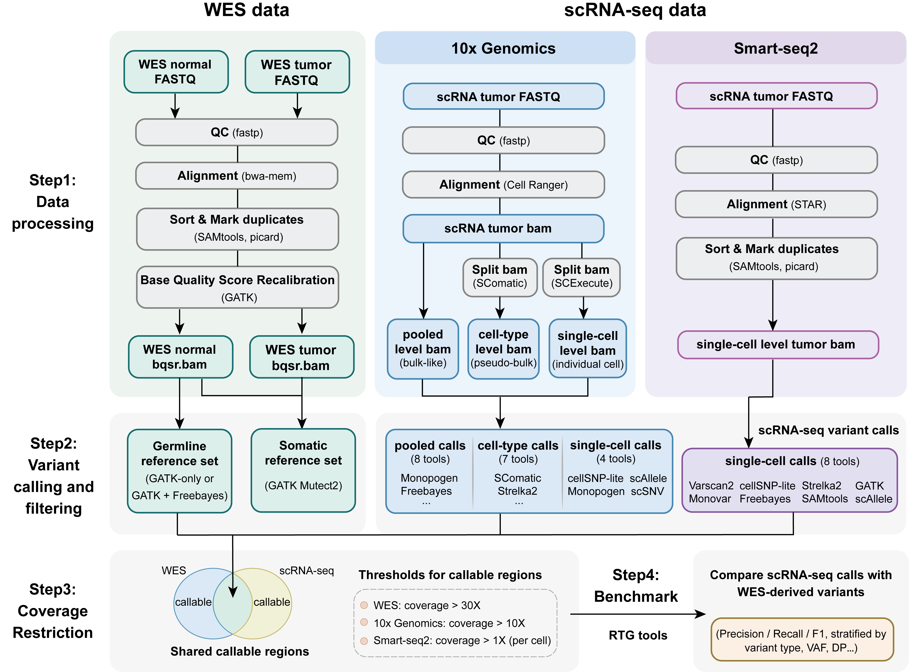
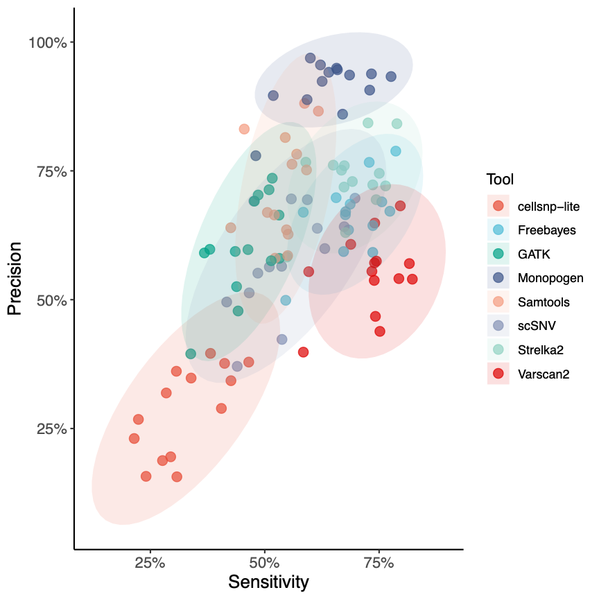
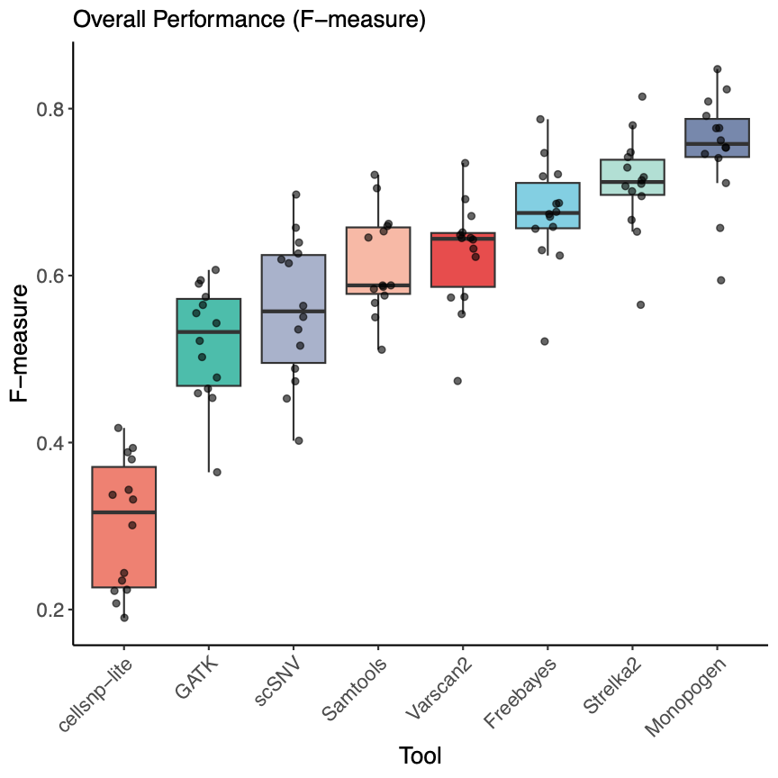
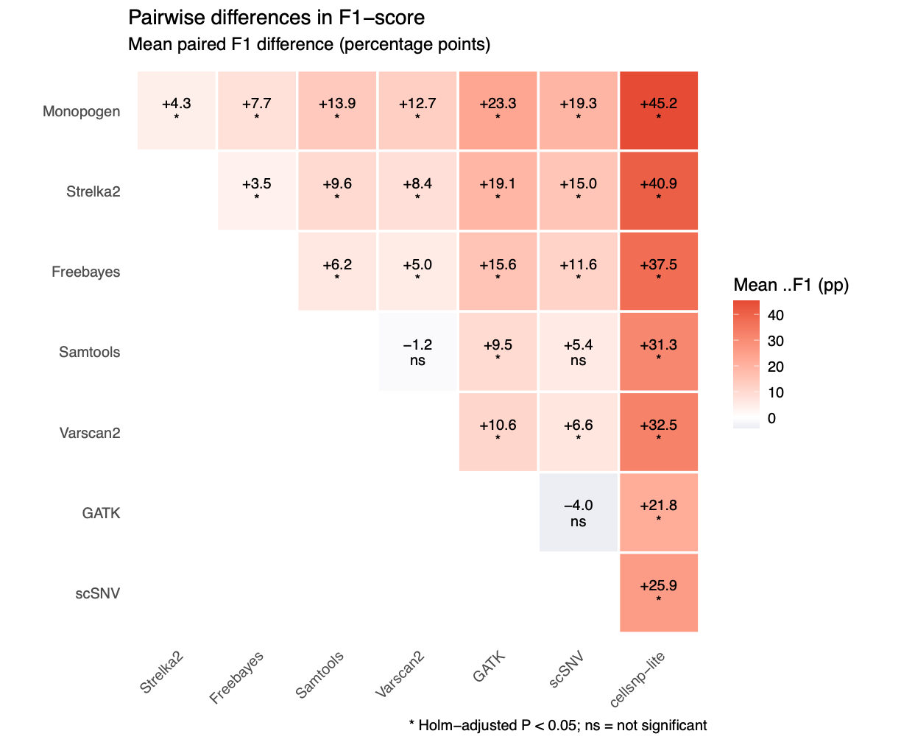
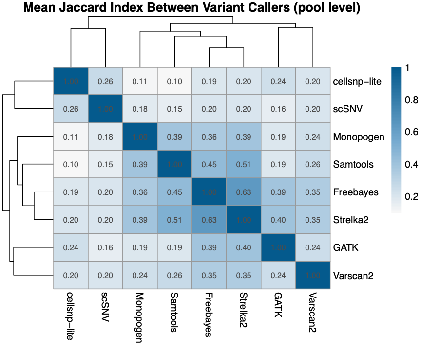
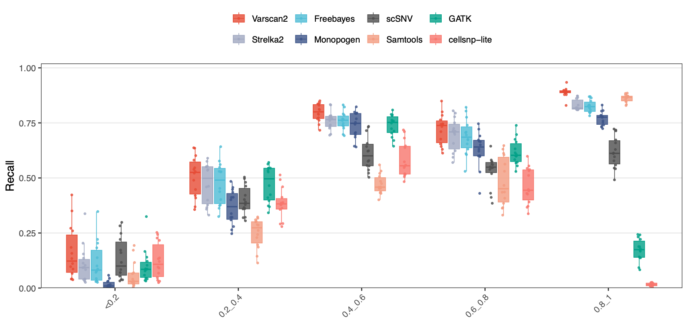
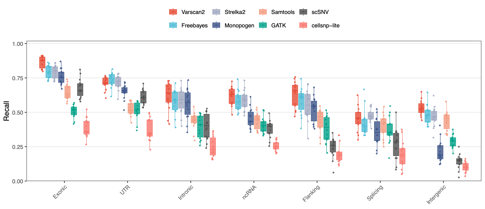
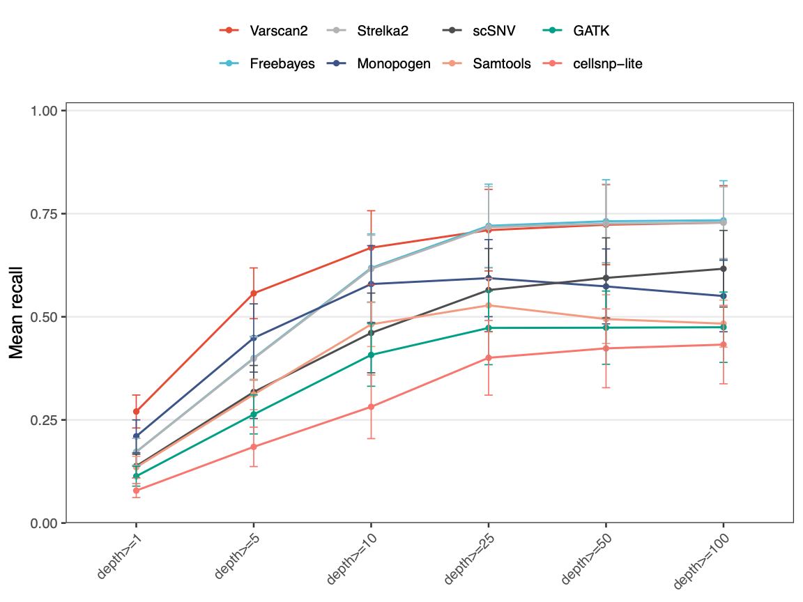
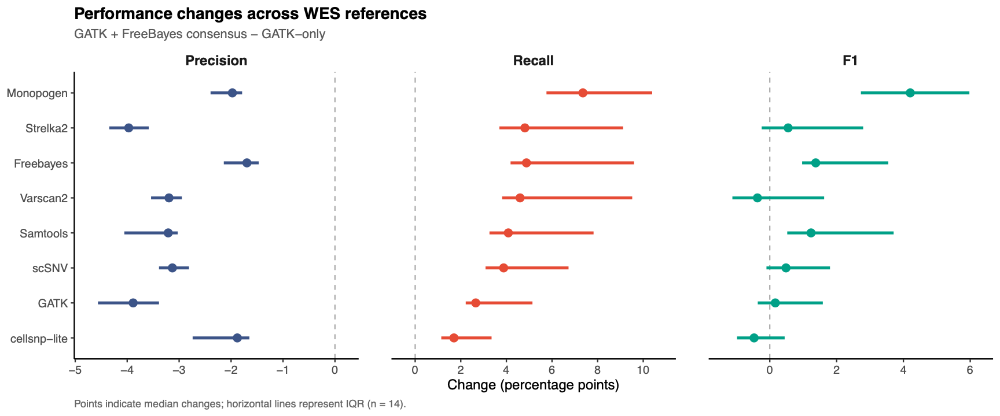

# Benchmark Evaluation {#benchmark-evaluation}


The benchmark constructs WES references, restricts evaluation to callable intervals, normalizes variant representations and compares calls with RTG Tools.

```{r,  echo=FALSE , out.width = "800px",fig.align = 'center',  fig.cap = 'Overview of the preprocessing and benchmarking workflow.' }
library(knitr)

```

## WES reference construction

Matched WES reads are processed with fastp, BWA-MEM, duplicate marking and BQSR. GATK HaplotypeCaller provides the primary WES reference. A normalized GATK–FreeBayes intersection provides the alternative reference for sensitivity analysis.

SNP hard filters use QD 2, QUAL 30, SOR 3, FS 60, MQ 40, MQRankSum −12.5 and ReadPosRankSum −8. Indel filters use QD 2, QUAL 30, FS 200 and ReadPosRankSum −20. The retained SNP and indel depth thresholds are >10 and >15, respectively.

## Callable regions

To ensure that variant calling performance was evaluated only in regions with sufficient sequencing coverage, callable genomic intervals were defined separately for each dataset and analysis unit. For 10x Genomics datasets, evaluation was restricted to regions with WES coverage ≥30× and pooled scRNA-seq coverage ≥10×. For Smart-seq2 datasets, WES coverage ≥30× and single-cell RNA-seq coverage ≥1× were required. Variants outside these regions were excluded from evaluation. Precision, recall, and F1-score were calculated using RTG vcfeval against matched WES reference callsets.

| Platform | WES coverage | RNA coverage | Evaluation unit |
|---|---|---|---|
| 10x | ≥30 | ≥10 | Matched sample or cell-type BAM |
| Smart-seq2 | ≥30 | ≥1 | Individual cell |

Coverage is calculated with mosdepth and the WES-covered intervals are intersected with the RNA-covered intervals. A WES variant outside that unit's callable intervals is excluded from its evaluation denominator.

<details>
<summary>10x callable intervals</summary>

```{bash native-10x-callable-intervals, eval=FALSE}
#!/usr/bin/env bash
WES_BAM_DIR=/mnt/storage/tantingting/scmut/bam/1_cSCC_WES
SCRNA_BAM_BASE=/mnt/storage/tantingting/scmut/bam/1_cSCC_scRNA
OUTDIR=/mnt/storage/tantingting/scmut/WES_gold/1_cSCC/region/whole

THREADS=16
MAPQ=20

cd "${OUTDIR}"
echo "[INFO] Start mosdepth for cSCC WES + scRNA"

############################################
# Part 1. cSCC WES (>30x)
############################################
for bam in ${WES_BAM_DIR}/P*_cSCC_*.bam; do
    sample=$(basename "${bam}" .bam)
    prefix="${sample}_WES"

    echo "[INFO] Processing WES: ${sample}"

    mosdepth -n -Q ${MAPQ} -t ${THREADS} --quantize 0:30:  "${prefix}" "${bam}"
    zcat "${prefix}.quantized.bed.gz" | awk '$4 == "30:inf" {print $1"\t"$2"\t"$3}' > "${prefix}_gt30_strict.bed"
done

############################################
# Part 2. cSCC scRNA (>10x, pooled cells)
############################################
for wes_bam in ${WES_BAM_DIR}/P*_cSCC_*.bam; do
    pid=$(basename "${wes_bam}" | cut -d_ -f1)   # P4, ...
    scrna_bam=${SCRNA_BAM_BASE}/${pid}_cSCC/outs/${pid}_cSCC_map.bam
    prefix="${pid}_cSCC_scRNA"

    echo "[INFO] Processing scRNA: ${pid}"
    mosdepth -n -Q ${MAPQ} -t ${THREADS} --quantize 0:10: "${prefix}" "${scrna_bam}"
    zcat "${prefix}.quantized.bed.gz" | awk '$4 == "10:inf" {print $1"\t"$2"\t"$3}' > "${prefix}_gt10_strict.bed"

############################################
# Step 3. Intersect callable bases and merge intervals.
############################################
echo "[INFO] Intersecting WES and scRNA regions for ${pid}..."

intersect_bed="${pid}_WES30_scRNA10_Shared_Genome.bed"
bedtools intersect -a "${wes_bed}" -b "${scrna_bed}" | bedtools sort -i - | bedtools merge -i - \
    > "${intersect_bed}"
done

echo "[INFO] All done."

############################################
# Step 4. Calculate the callable genomic length.
############################################

for wes_bed in P*_cSCC_*_WES_gt30_strict.bed; do
    pid=$(echo "${wes_bed}" | cut -d_ -f1)   # P2

    scrna_bed="${pid}_cSCC_scRNA_gt10_strict.bed"
    out_bed="${pid}_WES30_scRNA10_Shared_Genome.bed"

    echo "[INFO] Processing ${pid}"

    # Intersect callable bases and merge adjacent intervals.
    bedtools intersect -a "${wes_bed}" -b "${scrna_bed}" | bedtools sort -i - | bedtools merge -i - \
    > "${out_bed}"

    # Calculate the interval length.
    total_bp=$(awk '{sum += $3 - $2} END {print sum+0}' "${out_bed}")

    echo "[INFO] ${pid} callable genome:"
    echo "        ${total_bp} bp"
    echo "        $(awk -v x=${total_bp} 'BEGIN{printf "%.2f Mb\n", x/1e6}')"
done
```

</details>

<details>
<summary>Smart-seq2 callable intervals</summary>

```{bash native-smart-seq2-callable-intervals, eval=FALSE}
#!/usr/bin/env bash
MAP_FILE=/mnt/storage/tantingting/scmut_smart/bam/star_qc_unique_ge10k_scrna_sample_wes.tsv
TNBC_WES_DIR=/mnt/storage/tantingting/scmut_smart/bam/1_TNBC_WES/bam_md
TNBC_SCRNA_DIR=/mnt/storage/tantingting/scmut_smart/bam/1_TNBC_scRNA/md_bam
BRCA_WES_DIR=/mnt/storage/tantingting/scmut_smart/bam/2_BRCA_WES/bam_md
BRCA_SCRNA_DIR=/mnt/storage/tantingting/scmut_smart/bam/2_BRCA_scRNA/md_bam
OUTDIR=/mnt/storage/tantingting/scmut_smart/WES_gold/smartseq_callable

THREADS=16
MAPQ=20
mkdir -p "$OUTDIR"

echo "======================================"
echo "[INFO] Mapping file: $MAP_FILE"
echo "[INFO] Output: $OUTDIR"
echo "[INFO] WES DP >= 30; Smart-seq2 DP >= 1"
echo "======================================"

# Manifest columns: scRNA_SRR, Sample and WES_SRR.
tail -n +2 "$MAP_FILE" | while read -r scrna_srr sample wes_srr; do
    [[ -z "${scrna_srr:-}" || -z "${wes_srr:-}" ]] && continue

    # Identify the cohort from the BAM location and match the corresponding WES sample.
    if [[ -f "${TNBC_SCRNA_DIR}/${scrna_srr}_sortmd.bam" ]]; then
        cohort="TNBC"
        scrna_bam="${TNBC_SCRNA_DIR}/${scrna_srr}_sortmd.bam"
        wes_bam="${TNBC_WES_DIR}/${wes_srr}_sortmd.bam"
    elif [[ -f "${BRCA_SCRNA_DIR}/${scrna_srr}_sortmd.bam" ]]; then
        cohort="BRCA"
        scrna_bam="${BRCA_SCRNA_DIR}/${scrna_srr}_sortmd.bam"

        # Match BRCA cells to tumor WES only.
        wes_matches=("${BRCA_WES_DIR}"/*_Tumor_"${wes_srr}"_sortmd.bam)
        if [[ ${#wes_matches[@]} -ne 1 || ! -f "${wes_matches[0]}" ]]; then
            echo "[WARN] Skip ${scrna_srr}: BRCA tumor WES not uniquely found for ${wes_srr}"
            continue
        fi
        wes_bam="${wes_matches[0]}"
    else
        echo "[WARN] Skip ${scrna_srr}: scRNA BAM not found"
        continue
    fi

    if [[ ! -f "$wes_bam" ]]; then
        echo "[WARN] Skip ${scrna_srr}: WES BAM not found: ${wes_bam}"
        continue
    fi

    cohort_out="${OUTDIR}/${cohort}"
    mkdir -p "$cohort_out"/{wes_ge30,scrna_ge1,shared}

    wes_prefix="${cohort_out}/wes_ge30/${wes_srr}_WES"
    wes_bed="${cohort_out}/wes_ge30/${wes_srr}_WES_ge30.bed"
    scrna_prefix="${cohort_out}/scrna_ge1/${scrna_srr}_scRNA"
    scrna_bed="${cohort_out}/scrna_ge1/${scrna_srr}_scRNA_ge1.bed"
    shared_bed="${cohort_out}/shared/${scrna_srr}_${wes_srr}_WES30_scRNA1_shared.bed"
    stat_file="${cohort_out}/shared/${scrna_srr}_${wes_srr}_callable_size.tsv"

    echo "--------------------------------------"
    echo "[INFO] Cohort: ${cohort}"
    echo "[INFO] Sample: ${sample}"
    echo "[INFO] scRNA: ${scrna_srr}"
    echo "[INFO] WES: ${wes_srr}"

    # Calculate coverage once for each WES sample.
    if [[ ! -s "$wes_bed" ]]; then
        echo "[WES] Calculating DP >=30: ${wes_srr}"
        mosdepth -n -Q "$MAPQ" -t "$THREADS" --quantize 0:30: "$wes_prefix" "$wes_bam"

        zcat "${wes_prefix}.quantized.bed.gz" |
            awk '$4 == "30:inf" {print $1"\t"$2"\t"$3}' > "$wes_bed"
    else
        echo "[SKIP WES] Existing: ${wes_bed}"
    fi

    # Calculate DP >= 1 intervals separately for each Smart-seq2 cell.
    if [[ ! -s "$scrna_bed" ]]; then
        echo "[scRNA] Calculating DP >=1: ${scrna_srr}"
        mosdepth -n -Q "$MAPQ" -t "$THREADS" --quantize 0:1: "$scrna_prefix" "$scrna_bam"

        zcat "${scrna_prefix}.quantized.bed.gz" |
            awk '$4 == "1:inf" {print $1"\t"$2"\t"$3}'> "$scrna_bed"
    else
        echo "[SKIP scRNA] Existing: ${scrna_bed}"
    fi

    # Intersect WES DP >= 30 with this cell's scRNA DP >= 1 intervals.
    if [[ ! -s "$shared_bed" ]]; then
        echo "[INTERSECT] ${scrna_srr} × ${wes_srr}"
        bedtools intersect -a "$wes_bed" -b "$scrna_bed" |
            bedtools sort -i - |
            bedtools merge -i - > "$shared_bed"
    else
        echo "[SKIP INTERSECT] Existing: ${shared_bed}"
    fi

    total_bp=$(awk '{sum += $3-$2} END {print sum+0}' "$shared_bed")
    total_mb=$(awk -v bp="$total_bp" 'BEGIN {printf "%.4f", bp/1000000}')

    {
        echo -e "cohort\tsample\tscRNA_SRR\tWES_SRR\tcallable_bp\tcallable_Mb"
        echo -e "${cohort}\t${sample}\t${scrna_srr}\t${wes_srr}\t${total_bp}\t${total_mb}"
    } > "$stat_file"

    echo "[INFO] Callable region: ${total_bp} bp (${total_mb} Mb)"
done

# Combine callable lengths across cells.
summary="${OUTDIR}/all_cells_callable_size.tsv"
echo -e "cohort\tsample\tscRNA_SRR\tWES_SRR\tcallable_bp\tcallable_Mb" > "$summary"

find "$OUTDIR" -path "*/shared/*_callable_size.tsv" -type f | sort |
while read -r file; do
    tail -n 1 "$file"
done >> "$summary"

echo "======================================"
echo "[INFO] All done"
echo "[INFO] Summary: ${summary}"
echo "======================================"
```

</details>

## Normalize and compare with RTG

Variant calls from each tool were compared against matched whole-exome sequencing (WES) reference callsets using RTG Tools (`vcfeval`). Evaluation was restricted to predefined shared genomic regions with sufficient sequencing coverage.

<details>
<summary>RTG evaluation</summary>

```{bash native-rtg-evaluation, eval=FALSE}
#!/bin/bash

MANIFEST=/mnt/storage/tantingting/scmut/isec/vcf_manifest_pool_D1D2.tsv
REF_SDF=/home/tantingting/scmut/ref/bwa_ref/genome.sdf
OUT_BASE=/mnt/storage/tantingting/scmut/isec

mkdir -p ${OUT_BASE}/pool_sites
mkdir -p ${OUT_BASE}/summary_logs

SITE_SUMMARY=${OUT_BASE}/summary_logs/site_intersection.tsv

echo -e "sample\ttool\ttotal_sites\tintersect_sites" \
> ${SITE_SUMMARY}

while read sample tool vcf
do
    [[ $sample == "sample" ]] && continue

    echo "================================================="
    echo "${sample} ${tool}"
    echo "================================================="

    ####################################################
    # dataset1 cSCC
    ####################################################
    if [[ $sample == P*_cSCC ]]; then

        WES_VCF="/mnt/storage/tantingting/scmut/vcf/1_cSCC_WES/hap22/${sample}_hap_PASS3.vcf.gz"

        prefix=${sample%%_*}

        BED="/mnt/storage/tantingting/scmut/WES_gold/1_cSCC/region/whole/${prefix}_WES30_scRNA10_Shared_Genome.bed"

    ####################################################
    # dataset2 melanoma
    ####################################################
    else

        case $sample in
            Cutaneous1Lym) wes=SRR21849525 ;;
            Cutaneous2)    wes=SRR21849526 ;;
            Cutaneous1)    wes=SRR21849527 ;;
            Acral4)        wes=SRR21849528 ;;
            Acral3post)    wes=SRR21849529 ;;
            Acral3pre)     wes=SRR21849530 ;;
            Acral2)        wes=SRR21849531 ;;
            Acral1)        wes=SRR21849532 ;;
        esac

        WES_VCF="/mnt/storage/tantingting/scmut/vcf/2_melanoma_WES/hap/filter/${wes}_PASS.vcf.gz"

        BED="/mnt/storage/tantingting/scmut/WES_gold/2_melanoma/region/whole/${sample}_Shared_Genome.bed"

    fi

    OUTDIR=${OUT_BASE}/pool_sites/${sample}_${tool}

    mkdir -p ${OUTDIR}

    ####################################################
    # RTG
    ####################################################
    RTG_OUT=${OUTDIR}/rtg

    rm -rf ${RTG_OUT}

    rtg vcfeval \
        -b "$WES_VCF" \
        -c "$vcf" \
        --bed-regions "$BED" \
        -t "$REF_SDF" \
        -o "$RTG_OUT" \
        --squash-ploidy \
        --output-mode=annotate \
        > ${OUTDIR}/rtg.log 2>&1

    echo "[INFO] done ${sample} ${tool}"

done < ${MANIFEST}

echo
echo "ALL FINISHED"
```


## Core result figures

### Overall performance: 10x pooled

<details>
<summary>Overall performance 10x pooled</summary>

```{r, eval=FALSE}
library(tidyverse)
library(ggplot2)
library(dplyr)
library(tidyr)
library(ggrepel)
library(ggsci)

df <- read.table( "/mnt/storage/tantingting/scmut/isec/summary_logs/rtg_summary.tsv",
  header = TRUE, sep = "\t",stringsAsFactors = FALSE,as.is = T)

# -------------------------------------------------------------------------
# Figure 1. Precision-recall scatter plot.
# -------------------------------------------------------------------------
p1 <- ggplot(df, aes(x = Sensitivity, y = Precision, color = Tool)) +
  geom_point(size = 3, alpha = 0.8) +
  scale_color_npg() +
  scale_x_continuous(limits = c(0, 1), labels = scales::percent) +
  scale_y_continuous(limits = c(0, 1), labels = scales::percent) +
  theme_classic() +
  theme(legend.position = "right") +
  labs(title = "Precision vs. Sensitivity", subtitle = "Comparison against WES Gold Standard",
    x = "Sensitivity (Recall)", y = "Precision", color = "Tool")   +
  theme(
    axis.text = element_text(size = 11),  # Set the axis tick-label font size.
    axis.title = element_text(size = 13) # Set the axis title font size.
  )
ggsave(p1, filename = "/mnt/storage/tantingting/scmut/figure_D1D2/figure2/2c.wes_isec_presen_pool.pdf",
  width = 6, height = 6, units = "in" )

# Add caller-specific ellipses.
p1 <- ggplot(df, aes(x = Sensitivity, y = Precision, color = Tool)) +

  geom_point(size = 3, alpha = 0.7) +

  stat_ellipse( aes(fill = Tool), geom = "polygon", alpha = 0.12, color = NA
  ) +

  scale_color_npg() +
  scale_fill_npg() +

  scale_x_continuous(labels = scales::percent) +
  scale_y_continuous(labels = scales::percent) +

  theme_classic() +
  theme( legend.position = "right", axis.text = element_text(size = 11), axis.title = element_text(size = 13)
  )

ggsave(p1, filename = "/mnt/storage/tantingting/scmut/figure_D1D2/figure2/2c.wes_isec_presen_pool2.pdf",
  width = 6, height = 6, units = "in" )
# -------------------------------------------------------------------------
# Figure 2. F-measure boxplots ordered by performance.
# -------------------------------------------------------------------------
p2 <- ggplot(df, aes(x = reorder(Tool, F_measure, median), y = F_measure, fill = Tool)) +
  geom_boxplot(alpha = 0.7, outlier.shape = NA) +
  geom_jitter(width = 0.15, size = 1.5, alpha = 0.6) + # Display individual sample points.
  scale_fill_npg() +
  theme_classic() +
  labs(title = "Overall Performance (F-measure)", x = "Tool", y = "F-measure") +
  theme( axis.text.x = element_text(angle = 45, hjust = 1), axis.text = element_text(size = 11),
    axis.title = element_text(size = 13), legend.position = "none" )

ggsave(p2, filename = "/mnt/storage/tantingting/scmut/figure_D1D2/figure2/2c.wes_isec_f1_pool.pdf", width = 6,
  height = 6, units = "in" )

# -------------------------------------------------------------------------
# Figure 3. F-measure boxplots ordered by performance.
# -------------------------------------------------------------------------
library(tidyverse)

INFILE <- "/mnt/storage/tantingting/scmut/isec/summary_logs/rtg_summary.tsv"
OUTDIR <- "/mnt/storage/tantingting/scmut/figure_D1D2/figure2/statistics"
dir.create(OUTDIR, recursive = TRUE, showWarnings = FALSE)

tools <- c("Monopogen", "Strelka2", "Freebayes", "Samtools",
           "Varscan2", "GATK", "scSNV", "cellsnp-lite")

df <- read.delim(INFILE) %>%
  transmute(Sample, Tool, F1 = F_measure) %>%
  mutate(Tool = factor(Tool, levels = tools))

stopifnot(!anyDuplicated(df[c("Sample", "Tool")]))
stopifnot(n_distinct(df$Sample) == 14, nrow(df) == 112, !anyNA(df$F1))

# Friedman test
friedman <- friedman.test(F1 ~ Tool | Sample, data = df)
# 2. All 28 paired Wilcoxon comparisons
wide <- df %>% select(Sample, Tool, F1) %>%
  pivot_wider(names_from = Tool, values_from = F1)
pairs <- combn(tools, 2, simplify = FALSE)

res <- map_dfr(pairs, function(x) {
  d <- wide[[x[1]]] - wide[[x[2]]]
  p <- suppressWarnings(wilcox.test(d, exact = FALSE)$p.value)

  tibble(Tool1 = x[1], Tool2 = x[2], N = length(d),
         Mean_diff = mean(d), Median_diff = median(d), P_value = p)
}) %>%
  mutate(P_adj = p.adjust(P_value, method = "holm"),
         Significance = case_when(
           P_adj < 0.001 ~ "***", P_adj < 0.01 ~ "**",
           P_adj < 0.05 ~ "*", TRUE ~ "ns"
         ))

# 3. Pairwise significance heatmap

plot_df <- res %>%
  mutate(
    Tool1 = factor(Tool1, levels = rev(tools)),
    Tool2 = factor(Tool2, levels = tools),
    Delta_pp = Mean_diff * 100,
    Label = sprintf("%+.1f\n%s", Delta_pp, Significance)
  )

p <- ggplot(plot_df, aes(Tool2, Tool1, fill = Delta_pp)) +
  geom_tile(color = "white", linewidth = 0.8) +
  geom_text(aes(label = Label), size = 3.5, lineheight = 0.9) +
  scale_fill_gradient2(low = "#3C5488", mid = "white", high = "#E64B35",
                       midpoint = 0, name = "Mean ΔF1 (pp)") +
  coord_fixed() +
  theme_minimal(base_size = 12) +
  theme(panel.grid = element_blank(),
        axis.text.x = element_text(angle = 45, hjust = 1),
        axis.title = element_blank()) +
  labs(title = "Pairwise differences in F1-score",
       subtitle = "Mean paired F1 difference (percentage points)",
       caption = "* Holm-adjusted P < 0.05; ns = not significant")

ggsave(file.path(OUTDIR, "Pairwise_F1_difference_pp.pdf"),
       p, width = 8.5, height = 7)
```
</details>
```{r,  echo=FALSE , out.width = "400px",fig.align = 'center',  fig.cap = 'Precision-recall dotplot and F1-score boxplot evaluating pooled-level calling performance against matched bulk WES data across 14 samples, restricted to regions with ≥30X WES coverage and >10X scRNA-seq coverage.' }
library(knitr)

```

```{r,  echo=FALSE , out.width = "400px",fig.align = 'center',  fig.cap = 'Precision-recall dotplot and F1-score boxplot evaluating variant-calling performance in epithelial cells against matched bulk WES data.' }
library(knitr)

```

```{r,  echo=FALSE , out.width = "600px",fig.align = 'center',  fig.cap = 'Pairwise differences in F1-scores between variant callers across 14 samples using the GATK-only reference set.' }
library(knitr)

```

### Tool concordance: 10x pooled


<details>
<summary>Tool concordance</summary>

```{r, eval=FALSE}
### ===== Libraries =====
library(tidyverse)
library(pheatmap)
options(scipen = 999)

### ===== Input =====
base_dir <- "pool_sites"
files <- list.files(base_dir, recursive = TRUE, full.names = TRUE)

query_files <- files[grepl("query\\.keys$", files)]

### ===== Parse sample / tool =====
df <- tibble(file = query_files) %>%
  mutate( sample_tool = basename(dirname(file)), sample = sub("_.*", "", sample_tool),
    tool   = sub(".*_", "", sample_tool), sites  = map(file, ~ unique(readLines(.x))) )

### ===== Jaccard function =====
calc_jaccard <- function(a, b) {
  length(intersect(a, b)) / length(union(a, b))
}

jac <- df %>%
  inner_join(df, by = "sample", suffix = c("_1", "_2")) %>%
  mutate(jaccard = map2_dbl(sites_1, sites_2, calc_jaccard)) %>%
  group_by(tool_1, tool_2) %>%
  summarise(mean_jaccard = mean(jaccard, na.rm = TRUE), .groups = "drop")

mat <- jac %>%
  pivot_wider(names_from = tool_2, values_from = mean_jaccard) %>%
  column_to_rownames("tool_1") %>%
  as.matrix()

pdf("/mnt/storage/tantingting/scmut/figure_D1D2/figure2/2b.Mean_Jaccard_heatmap_pool.pdf", width = 6, height = 5)

pheatmap( mat, color =  colorRampPalette( c("#F7F7F7", "#74A9CF", "#045A8D")
)(100), display_numbers = TRUE, number_format = "%.2f",
  main = "Mean Jaccard Index Between Variant Callers (pool level)" )

dev.off()
```

</details>

```{r,  echo=FALSE , out.width = "600px",fig.align = 'center',  fig.cap = 'Heatmaps of the mean Jaccard Index illustrating the concordance between tools at the pooled level. ' }
library(knitr)

```

### Robustness analysis: 10x pooled

<details>
<summary>Performance across different variant allele frequency</summary>

**Stratify WES variants by VAF:**

```{bash, eval=FALSE}
WES_BASE="/mnt/storage/tantingting/scmut/vcf/2_melanoma_WES/hap/filter"
OUT_BASE="/mnt/storage/tantingting/scmut/isec/wes_condition/vaf"

declare -A WES
WES[Acral1]=SRR21849532
WES[Acral2]=SRR21849531
WES[Acral3pre]=SRR21849530
WES[Acral3post]=SRR21849529
WES[Acral4]=SRR21849528
WES[Cutaneous1]=SRR21849527
WES[Cutaneous2]=SRR21849526
WES[Cutaneous1Lym]=SRR21849525

bins=("lt0.2" "0.2_0.4" "0.4_0.6" "0.6_0.8" "0.8_1")

for sample in "${!WES[@]}"; do

    wes=${WES[$sample]}

    echo "===== Processing $sample ====="

    in_vcf="${WES_BASE}/${wes}_PASS.vcf.gz"
    out_dir="${OUT_BASE}/${sample}"

    mkdir -p "$out_dir"

    [[ ! -f "$in_vcf" ]] && {
        echo "[WARN] missing $in_vcf"
        continue
    }

    zcat "$in_vcf" | awk -v out_dir="$out_dir" -v sample="$sample" '

    BEGIN{
        FS=OFS="\t"
        bins[1]="lt0.2"
        bins[2]="0.2_0.4"
        bins[3]="0.4_0.6"
        bins[4]="0.6_0.8"
        bins[5]="0.8_1"
    }

    /^#/{
        for(i=1;i<=5;i++){
            out=out_dir "/" sample "." bins[i] ".vcf"
            print >> out
        }
        next
    }

    {
        if($5~/,/) next

        nfmt=split($9,fmt_arr,":")
        nsmp=split($10,smp_arr,":")

        ad_idx=0

        for(i=1;i<=nfmt;i++){
            if(fmt_arr[i]=="AD"){
                ad_idx=i
                break
            }
        }

        if(ad_idx==0 || ad_idx>nsmp) next

        ad=smp_arr[ad_idx]

        if(ad!~/^[0-9]+,[0-9]+$/) next

        split(ad,a,",")

        refc=a[1]+0
        altc=a[2]+0

        dp=refc+altc

        if(dp<=0) next

        vaf=altc/dp

        if(vaf<0.2)
            bin="lt0.2"
        else if(vaf<0.4)
            bin="0.2_0.4"
        else if(vaf<0.6)
            bin="0.4_0.6"
        else if(vaf<0.8)
            bin="0.6_0.8"
        else
            bin="0.8_1"

        out=out_dir "/" sample "." bin ".vcf"

        print >> out
    }
    '

    for b in "${bins[@]}"; do

        vcf="${out_dir}/${sample}.${b}.vcf"

        if [[ -s "$vcf" ]]; then
            bgzip -f "$vcf"
            tabix -f -p vcf "${vcf}.gz"
        else
            rm -f "$vcf"
        fi

    done

    echo "[INFO] Done $sample"

done

echo "All done"
```

**Evaluate recall using RTG vcfeval:**

```{bash, eval=FALSE}
OUT_BASE="/mnt/storage/tantingting/scmut/isec/wes_condition/vaf"
MANIFEST="/mnt/storage/tantingting/scmut/isec/vcf_manifest_pool_D1D2.tsv"
REF_SDF="/home/tantingting/scmut/ref/bwa_ref/genome.sdf"
RESULT="${OUT_BASE}/vaf_recall_summary.tsv"
echo -e "sample\ttool\tvaf_bin\ttruth_n\trecall" > "$RESULT"
samples=(
"P4_cSCC" "P5_cSCC" "P6_cSCC" "P7_cSCC" "P9_cSCC" "P10_cSCC"
"Acral1" "Acral2" "Acral3pre" "Acral3post"
"Acral4" "Cutaneous1" "Cutaneous1Lym" "Cutaneous2"
)
bins=("lt0.2" "0.2_0.4" "0.4_0.6" "0.6_0.8" "0.8_1")

for sample in "${samples[@]}"; do

    echo "===== Processing ${sample} ====="
    sample_out="${OUT_BASE}/${sample}"
    log_dir="${sample_out}/logs"
    mkdir -p "$log_dir"


    bed_file="/mnt/storage/tantingting/scmut/WES_gold/2_melanoma/region/whole/${sample}_Shared_Genome.bed"


    [[ ! -f "$bed_file" ]] && {
        echo "[WARN] missing BED: $bed_file"
        continue
    }

    awk -v s="$sample" '
        NR > 1 && $1 == s {
            print $1 "\t" $2 "\t" $3
        }
    ' "$MANIFEST" |

    while IFS=$'\t' read -r sample2 tool scrna_vcf
    do

        echo "[INFO] ${sample2} | ${tool}"
        for bin in "${bins[@]}"; do
            truth_vcfgz="${sample_out}/${sample}.${bin}.vcf.gz"
            [[ ! -f "$truth_vcfgz" ]] && continue

            truth_n=$(zgrep -vc '^#' "$truth_vcfgz")
            rtg_out="${sample_out}/rtg_${tool}_${bin}"
            log_file="${log_dir}/${sample}_${tool}_${bin}.log"

            rm -rf "$rtg_out"
            rtg vcfeval -b "$truth_vcfgz" -c "$scrna_vcf" --bed-regions "$bed_file" -t "$REF_SDF" \
                -o "$rtg_out" --squash-ploidy --output-mode=annotate > "$log_file" 2>&1

            summary_file="${rtg_out}/summary.txt"

            recall="NA"

            if [[ -f "$summary_file" ]]; then

                recall=$(awk '
                    BEGIN { rec = "NA" }
                    $1 == "None" { rec = $7 }
                    END { print rec }
                ' "$summary_file")

                if [[ "$recall" == "NA" || -z "$recall" ]]; then

                    recall=$(awk '
                        /^[[:space:]-]+$/ { next }
                        /^Threshold/      { next }
                        NF >= 7 && ($1 ~ /^[0-9.]+$/ || $1 == "None") { rec = $7 }
                        END {
                            if (rec == "") print "NA";
                            else print rec
                        }
                    ' "$summary_file")

                fi

            fi

            echo -e "${sample}\t${tool}\tvaf_${bin}\t${truth_n}\t${recall}" >> "$RESULT"

        done

    done

done

echo "Done: $RESULT"
```

**Visualize VAF-dependent recall:**

```{r, eval=FALSE}
library(tidyverse)
df <- read.table( "/mnt/storage/tantingting/scmut/isec/wes_condition/vaf/vaf_recall_summary.tsv",
  header = TRUE, sep = "\t", stringsAsFactors = FALSE )

df$vaf_bin <- gsub("^vaf_", "", df$vaf_bin)

df$vaf_bin <- factor( df$vaf_bin, levels = c("lt0.2", "0.2_0.4", "0.4_0.6", "0.6_0.8", "0.8_1"),
  labels = c("<0.2", "0.2_0.4", "0.4_0.6", "0.6_0.8", "0.8_1") )

tool_order <- df %>%
  group_by(tool) %>%
  summarise(mean_recall = mean(recall, na.rm = TRUE), .groups = "drop") %>%
  arrange(desc(mean_recall)) %>%
  pull(tool)
df$tool <- factor(df$tool, levels = tool_order)

p <- ggplot(df, aes(x = vaf_bin, y = recall, fill = tool, color = tool)) +
  geom_boxplot( position = position_dodge(width = 0.8), width = 0.7, outlier.shape = NA, alpha = 0.8,
    linewidth = 0.35
  ) +
  geom_point( position = position_jitterdodge(jitter.width = 0.12, dodge.width = 0.8), size = 0.8, alpha = 0.8
  ) +
  scale_fill_manual(values = tool_cols) +
  scale_color_manual(values = tool_cols) +
  scale_y_continuous(limits = c(0, 1), expand = expansion(mult = c(0, 0.02))) +
  labs(x = NULL, y = "Recall", fill = NULL, color = NULL) +
  theme_bw(base_size = 13) +
  theme( panel.grid.major.x = element_blank(), panel.grid.minor = element_blank(),
    axis.text.x = element_text(angle = 45, hjust = 1), legend.position = "top", legend.title = element_blank()
  )
ggsave("/mnt/storage/tantingting/scmut/figure_D1D2/figure2/2g.vaf_recall_boxplot.pdf",
  p, width = 11, height = 5.2)
```

</details>

```{r,  echo=FALSE , out.width = "400px",fig.align = 'center',  fig.cap = 'Robustness analysis showing performance across different variant allele frequency (VAF).', out.width='100%', fig.show='hold' }
library(knitr)

```

<details>
<summary>Performance across genomic region</summary>

**ANNOVAR annotation:**

```{bash, eval=FALSE}
ANNOVAR_DIR="/home/tantingting/scmut/tools/annovar"
ANNOVAR_DB="/home/tantingting/scmut/tools/annovar/humandb"
WES_BASE="/mnt/storage/tantingting/scmut/vcf/2_melanoma_WES/hap/filter"
OUT_BASE="/mnt/storage/tantingting/scmut/annovar/wes_D2"
LOG="${OUT_BASE}/annovar_melanoma.log"

mkdir -p "$OUT_BASE"
: > "$LOG"

samples=(
    Acral1 Acral2 Acral3pre Acral3post Acral4
    Cutaneous1 Cutaneous1Lym Cutaneous2
)

# Map melanoma samples to matched WES accessions
declare -A wes_map=(
    [Acral1]=SRR21849532
    [Acral2]=SRR21849531
    [Acral3pre]=SRR21849530
    [Acral3post]=SRR21849529
    [Acral4]=SRR21849528
    [Cutaneous1]=SRR21849527
    [Cutaneous2]=SRR21849526
    [Cutaneous1Lym]=SRR21849525
)

for sample in "${samples[@]}"; do
    wes=${wes_map[$sample]}
    vcf="${WES_BASE}/${wes}_PASS.vcf.gz"
    tmp_vcf="${OUT_BASE}/${sample}.tmp.vcf"

    echo ">>> ${sample}" | tee -a "$LOG"
    if [[ ! -f "$vcf" ]]; then
        echo "[WARN] Missing VCF: $vcf" | tee -a "$LOG"
        continue
    fi

    zcat "$vcf" > "$tmp_vcf"

    # Annotate gene regions
    "${ANNOVAR_DIR}/table_annovar.pl" "$tmp_vcf" "$ANNOVAR_DB" \
        -buildver hg38 \
        -out "${OUT_BASE}/${sample}" \
        -protocol refGeneWithVer,rna_editing \
        -operation g,f \
        -nastring . \
        -vcfinput >> "$LOG" 2>&1

    rm -f "$tmp_vcf"
done
```

**Classify variants by genomic region:**

```{bash,eval=FALSE}
# Classify annotated WES variants into genomic regions
WES_BASE="/mnt/storage/tantingting/scmut/annovar/wes_D2"
OUT_BASE="/mnt/storage/tantingting/scmut/isec/wes_condition/region"

samples=(
    Acral1 Acral2 Acral3pre Acral3post Acral4
    Cutaneous1 Cutaneous1Lym Cutaneous2
)
regions=("Splicing" "Exonic" "Intronic" "UTR" "ncRNA" "Flanking" "Intergenic" "Other")

for sample in "${samples[@]}"; do
    echo "===== Processing $sample ====="
    in_vcf="${WES_BASE}/${sample}.hg38_multianno.vcf"
    out_dir="${OUT_BASE}/${sample}"
    mkdir -p "$out_dir"

    if [[ ! -f "$in_vcf" ]]; then
        echo "[WARN] Missing $in_vcf"
        continue
    fi

    # Assign each variant to a functional genomic category
    awk -v out_dir="$out_dir" -v sample="$sample" '
    BEGIN {
        FS = OFS = "\t"
        regions[1] = "Splicing"
        regions[2] = "Exonic"
        regions[3] = "Intronic"
        regions[4] = "UTR"
        regions[5] = "ncRNA"
        regions[6] = "Flanking"
        regions[7] = "Intergenic"
        regions[8] = "Other"
    }
    /^#/ {
        for (i = 1; i <= 8; i++) {
            out = out_dir "/" sample "." regions[i] ".vcf"
            print >> out
        }
        next
    }
    {
        info = $8
        funcanno = ""
        category = "Other"

        n = split(info, arr, ";")
        for (i = 1; i <= n; i++) {
            if (arr[i] ~ /^Func\.refGeneWithVer=/) {
                split(arr[i], kv, "=")
                funcanno = kv[2]
                gsub("\\\\x3b", ";", funcanno)
                break
            }
        }

        if (funcanno == "splicing" || funcanno == "exonic;splicing" ||
            funcanno == "ncRNA_splicing" || funcanno == "ncRNA_exonic;splicing") {
            category = "Splicing"
        }
        else if (funcanno == "exonic") {
            category = "Exonic"
        }
        else if (funcanno == "intronic") {
            category = "Intronic"
        }
        else if (funcanno == "UTR3" || funcanno == "UTR5" ||
                 funcanno == "UTR5;UTR3" || funcanno == "UTR3;UTR5") {
            category = "UTR"
        }
        else if (funcanno == "ncRNA_exonic" || funcanno == "ncRNA_intronic") {
            category = "ncRNA"
        }
        else if (funcanno == "upstream" || funcanno == "downstream" ||
                 funcanno == "upstream;downstream") {
            category = "Flanking"
        }
        else if (funcanno == "intergenic") {
            category = "Intergenic"
        }

        out = out_dir "/" sample "." category ".vcf"
        print >> out
    }
    ' "$in_vcf"

    for r in "${regions[@]}"; do
        vcf="${out_dir}/${sample}.${r}.vcf"
        if [[ -s "$vcf" ]]; then
            bgzip -f "$vcf"
            tabix -f -p vcf "${vcf}.gz"
        else
            rm -f "$vcf"
        fi
    done

    echo "[INFO] Done $sample"
done

echo "All done"
```


**Evaluate region-specific recall using RTG vcfeval:**

```{bash,eval=FALSE}
OUT_BASE="/mnt/storage/tantingting/scmut/isec/wes_condition/region"
MANIFEST="/mnt/storage/tantingting/scmut/isec/vcf_manifest_pool_D1D2.tsv"
REF_SDF="/home/tantingting/scmut/ref/bwa_ref/genome.sdf"
BED_BASE="/mnt/storage/tantingting/scmut/WES_gold/2_melanoma/region/whole"
RESULT="${OUT_BASE}/region_recall_summary_D2.tsv"

mkdir -p "$OUT_BASE"
echo -e "sample\ttool\tregion\ttruth_n\trecall" > "$RESULT"

samples=(
    Acral1 Acral2 Acral3pre Acral3post Acral4
    Cutaneous1 Cutaneous1Lym Cutaneous2
)
regions=("Splicing" "Exonic" "Intronic" "UTR" "ncRNA" "Flanking" "Intergenic")

for sample in "${samples[@]}"; do
    echo "===== Processing ${sample} ====="
    sample_out="${OUT_BASE}/${sample}"
    bed_file="${BED_BASE}/${sample}_Shared_Genome.bed"

    if [[ ! -f "$bed_file" ]]; then
        echo "[WARN] Missing BED: $bed_file"
        continue
    fi

    # Read tool-specific scRNA-seq VCFs from the manifest
    awk -v s="$sample" '
        NR>1 && $1==s {print $1 "\t" $2 "\t" $3}
    ' "$MANIFEST" |
    while IFS=$'\t' read -r sample2 tool scrna_vcf; do
        echo "[INFO] ${sample2} | ${tool}"

        if [[ ! -f "$scrna_vcf" ]]; then
            echo "[WARN] Missing scRNA VCF: $scrna_vcf"
            continue
        fi

        for region in "${regions[@]}"; do
            region_vcfgz="${sample_out}/${sample}.${region}.vcf.gz"
            [[ ! -f "$region_vcfgz" ]] && continue

            # Count variants in the region-specific WES VCF
            truth_n=$(zgrep -vc '^#' "$region_vcfgz")
            rtg_out="${sample_out}/rtg_${tool}_${region}"
            mkdir -p "${sample_out}/logs"

            # Rerun RTG vcfeval for each tool and genomic region
            rm -rf "$rtg_out"
            rtg vcfeval \
                -b "$region_vcfgz" \
                -c "$scrna_vcf" \
                --bed-regions "$bed_file" \
                -t "$REF_SDF" \
                -o "$rtg_out" \
                --squash-ploidy \
                --output-mode=annotate \
                > "${sample_out}/logs/${tool}_${region}.log" 2>&1

            # Extract recall from the RTG summary
            summary_file="${rtg_out}/summary.txt"
            recall="NA"

            if [[ -f "$summary_file" ]]; then
                recall=$(awk '
                    BEGIN {r="NA"}
                    $1=="None" {r=$7}
                    END {print r}
                ' "$summary_file")
            fi

            echo -e "${sample}\t${tool}\t${region}\t${truth_n}\t${recall}" >> "$RESULT"
        done
    done
done

echo "Done: $RESULT"
```

**Visualize recall across genomic regions:**

```{R,eval=FALSE}
library(tidyverse)
df <- read.table("/mnt/storage/tantingting/scmut/isec/wes_condition/region/region_recall_summary_D2.tsv", header = TRUE, sep = "\t", stringsAsFactors = FALSE)

tool_cols <- c(
  scSNV          = "#4D4D4D",
  Strelka2       = "#B3B3B3",
 `cellsnp-lite` = "#F8766D",
  Varscan2       = "#E64B35",
  GATK           = "#00A087",
  Samtools       = "#F39B7F",
  Freebayes      = "#4DBBD5",
  Monopogen      = "#3C5488"
)

region_order <- df %>%
  group_by(region) %>%
  summarise(mean_recall = mean(recall, na.rm = TRUE)) %>%
  arrange(desc(mean_recall)) %>%
  pull(region)
df$region <- factor(df$region, levels = region_order)

tool_order <- df %>%
  group_by(tool) %>%
  summarise(mean_recall = mean(recall, na.rm = TRUE)) %>%
  arrange(desc(mean_recall)) %>%
  pull(tool)
df$tool <- factor(df$tool, levels = tool_order)

p <- ggplot(df, aes(x = region, y = recall, fill = tool, color = tool)) +
  geom_boxplot( position = position_dodge(width = 0.8), width = 0.7, outlier.shape = NA, alpha = 0.8,
    linewidth = 0.35
  ) +
  geom_point( position = position_jitterdodge(jitter.width = 0.12, dodge.width = 0.8), size = 0.8, alpha = 0.8
  ) +
  scale_fill_manual(values = tool_cols) +
  scale_color_manual(values = tool_cols) +
  scale_y_continuous(limits = c(0, 1), expand = expansion(mult = c(0, 0.02))) +
  labs( x = NULL, y = "Recall", fill = NULL, color = NULL
  ) +
  theme_bw(base_size = 13) +
  theme( panel.grid.major.x = element_blank(), panel.grid.minor = element_blank(),
    axis.text.x = element_text(angle = 45, hjust = 1, vjust = 1), legend.position = "top",
    legend.title = element_blank(), strip.background = element_blank(),
    strip.text = element_text(face = "bold"), plot.title = element_text(face = "bold") )
ggsave("/mnt/storage/tantingting/scmut/figure_D1D2/figure2/2g.region_recall_boxplot.pdf", p, width = 12, height = 5.2)
```

</details>

```{r,  echo=FALSE , out.width = "400px",fig.align = 'center',  fig.cap = 'Robustness analysis showing performance across different genomic regions. ', out.width='100%', fig.show='hold' }
library(knitr)

```

<details>
<summary>Performance across different sequencing depth</summary>

**Calculate scRNA-seq depth at WES variant sites:**
```{bash, eval=FALSE}
WES_BASE="/mnt/storage/tantingting/scmut/vcf/2_melanoma_WES/hap/filter"
BAM_MANIFEST="/mnt/storage/tantingting/scmut/isec/scrna_bam_manifest_D2.tsv"
OUT_BASE="/mnt/storage/tantingting/scmut/isec/wes_condition/dp"

declare -A WES
WES[Acral1]=SRR21849532
WES[Acral2]=SRR21849531
WES[Acral3pre]=SRR21849530
WES[Acral3post]=SRR21849529
WES[Acral4]=SRR21849528
WES[Cutaneous1]=SRR21849527
WES[Cutaneous2]=SRR21849526
WES[Cutaneous1Lym]=SRR21849525

for sample in "${!WES[@]}"; do

    echo "===== Processing $sample ====="
    wes=${WES[$sample]}
    wes_vcf="${WES_BASE}/${wes}_PASS.vcf.gz"
    sample_out="${OUT_BASE}/${sample}"
    mkdir -p "$sample_out"

    bam=$(awk -v s="$sample" '
        NR>1 && $1==s {
            print $2
        }
    ' "$BAM_MANIFEST")

    if [[ ! -f "$wes_vcf" ]]; then
        echo "[WARN] missing WES VCF: $wes_vcf"
        continue
    fi

    if [[ ! -f "$bam" ]]; then
        echo "[WARN] missing BAM: $bam"
        continue
    fi

    bcftools query -f '%CHROM\t%POS\t%REF\t%ALT\n' "$wes_vcf" |
    awk '
        BEGIN{FS=OFS="\t"}
        {
            print $1,$2-1,$2,$1":"$2":"$3":"$4
        }
    ' > "${sample_out}/${sample}.truth_sites.bed"

    samtools depth -a -b "${sample_out}/${sample}.truth_sites.bed" "$bam" \
        > "${sample_out}/${sample}.truth_sites.depth.tsv"

    echo "[INFO] Done $sample"

done

echo "All done"
```

**Stratify WES variants by scRNA-seq depth:**

```{bash, eval=FALSE}
WES_BASE="/mnt/storage/tantingting/scmut/vcf/2_melanoma_WES/hap/filter"
OUT_BASE="/mnt/storage/tantingting/scmut/isec/wes_condition/dp"

declare -A WES=(
[Acral1]=SRR21849532
[Acral2]=SRR21849531
[Acral3pre]=SRR21849530
[Acral3post]=SRR21849529
[Acral4]=SRR21849528
[Cutaneous1]=SRR21849527
[Cutaneous2]=SRR21849526
[Cutaneous1Lym]=SRR21849525
)

thresholds=("1" "5" "10" "25" "50" "100")

for sample in "${!WES[@]}"; do

    echo "===== Processing $sample ====="

    WES_VCF="${WES_BASE}/${WES[$sample]}_PASS.vcf.gz"
    SAMPLE_OUT="${OUT_BASE}/${sample}"

    BED="${SAMPLE_OUT}/${sample}.truth_sites.bed"
    DEPTH="${SAMPLE_OUT}/${sample}.truth_sites.depth.tsv"
    TSV="${SAMPLE_OUT}/${sample}.truth_key_depth.tsv"

    awk '
    BEGIN{FS=OFS="\t"}
    FNR==NR {dp[$1":"$2]=$3; next}
    {
        coord=$1":"$3
        print $1,$3,$4,(coord in dp ? dp[coord] : 0)
    }' "$DEPTH" "$BED" > "$TSV"

    for th in "${thresholds[@]}"; do

        awk -v t="$th" 'BEGIN{FS=OFS="\t"} $4>=t{print $3}' \
            "$TSV" > "${SAMPLE_OUT}/${sample}.depthge${th}.keys.txt"

        key_txt="${SAMPLE_OUT}/${sample}.depthge${th}.keys.txt"
        out_vcf="${SAMPLE_OUT}/${sample}.depthge${th}.vcf"

        bcftools view -h "$WES_VCF" > "$out_vcf"

        bcftools view -H "$WES_VCF" | awk 'BEGIN{FS=OFS="\t"}
             FNR==NR {a[$1]=1; next}
             {
                 key=$1":"$2":"$4":"$5
                 if(key in a) print
             }' "$key_txt" - >> "$out_vcf"

        if grep -qv "^#" "$out_vcf"; then
            bgzip -f "$out_vcf"
            tabix -f -p vcf "${out_vcf}.gz"
            echo "[INFO] $sample depth>=$th : $(zgrep -vc "^#" "${out_vcf}.gz") variants"
        else
            rm -f "$out_vcf"
            echo "[INFO] $sample depth>=$th : 0 variants"
        fi

    done

done

echo "All done"
```

**Evaluate depth-dependent recall using RTG vcfeval:**
```{bash, eval=FALSE}
OUT_BASE="/mnt/storage/tantingting/scmut/isec/wes_condition/dp"
MANIFEST="/mnt/storage/tantingting/scmut/isec/vcf_manifest_pool_D1D2.tsv"
REF_SDF="/home/tantingting/scmut/ref/bwa_ref/genome.sdf"
RESULT="${OUT_BASE}/depth_recall_summary.tsv"
echo -e "sample\ttool\tdepth_threshold\ttruth_n\trecall" > "$RESULT"

samples=(
"P4_cSCC" "P5_cSCC" "P6_cSCC" "P7_cSCC" "P9_cSCC" "P10_cSCC"
"Acral1" "Acral2" "Acral3pre" "Acral3post"
"Acral4" "Cutaneous1" "Cutaneous1Lym" "Cutaneous2"
)

thresholds=("1" "5" "10" "25" "50" "100")

for sample in "${samples[@]}"; do

    echo "===== Processing ${sample} ====="
    sample_out="${OUT_BASE}/${sample}"
    log_dir="${sample_out}/logs"
    mkdir -p "$log_dir"

    awk -v s="$sample" '
        NR>1 && $1==s {
            print $1 "\t" $2 "\t" $3
        }
    ' "$MANIFEST" |

    while IFS=$'\t' read -r sample2 tool scrna_vcf
    do

        echo "[INFO] ${sample2} | ${tool}"

        for th in "${thresholds[@]}"; do

            truth_vcfgz="${sample_out}/${sample}.depthge${th}.vcf.gz"
            truth_n=$(zgrep -vc '^#' "$truth_vcfgz")
            rtg_out="${sample_out}/rtg_${tool}_depthge${th}"
            log_file="${log_dir}/${sample}_${tool}_depthge${th}.log"

            rm -rf "$rtg_out"
            rtg vcfeval -b "$truth_vcfgz" -c "$scrna_vcf" -t "$REF_SDF" -o "$rtg_out" --squash-ploidy \
                --output-mode=annotate > "$log_file" 2>&1
            summary_file="${rtg_out}/summary.txt"
            recall="NA"

            if [[ -f "$summary_file" ]]; then

                recall=$(awk '
                    BEGIN { rec="NA" }
                    $1=="None" { rec=$7 }
                    END { print rec }
                ' "$summary_file")

                if [[ "$recall" == "NA" || -z "$recall" ]]; then

                    recall=$(awk '
                        /^[[:space:]-]+$/ { next }
                        /^Threshold/      { next }
                        NF>=7 && ($1~/^[0-9.]+$/ || $1=="None") { rec=$7 }
                        END{
                            if(rec=="") print "NA"
                            else print rec
                        }
                    ' "$summary_file")
                fi
            fi
            echo -e "${sample}\t${tool}\tdepth>=${th}\t${truth_n}\t${recall}" >> "$RESULT"
        done
    done
done
echo "Done: $RESULT"
```

**Visualize recall across sequencing depth thresholds:**

```{r, eval=FALSE}
library(tidyverse)

df <- read.table("/mnt/storage/tantingting/scmut/isec/wes_condition/dp/depth_recall_summary.tsv", header = TRUE,
  sep = "\t", stringsAsFactors = FALSE)

tool_cols <- c(scSNV = "#4D4D4D", Strelka2 = "#B3B3B3", `cellsnp-lite` = "#F8766D", Varscan2 = "#E64B35", GATK = "#00A087",
  Samtools = "#F39B7F", Freebayes = "#4DBBD5", Monopogen = "#3C5488")

df$depth_threshold <- factor(df$depth_threshold, levels = c("depth>=1", "depth>=5", "depth>=10", "depth>=25", "depth>=50",
  "depth>=100"))

tool_order <- df %>%
  group_by(tool) %>%
  summarise(mean_recall = mean(recall, na.rm = TRUE), .groups = "drop") %>%
  arrange(desc(mean_recall)) %>%
  pull(tool)

df$tool <- factor(df$tool, levels = tool_order)

sum_df <- df %>%
  group_by(tool, depth_threshold) %>%
  summarise(mean_recall = mean(recall, na.rm = TRUE), sd_recall = sd(recall, na.rm = TRUE), mean_truth_n = mean(truth_n,
    na.rm = TRUE), .groups = "drop")

depth_info <- df %>%
  group_by(depth_threshold) %>%
  summarise(mean_truth_n = mean(truth_n, na.rm = TRUE), .groups = "drop")

p <- ggplot(sum_df, aes(x = depth_threshold, y = mean_recall, color = tool, group = tool)) +
  geom_line(linewidth = 0.7) +
  geom_point(size = 1.5) +
  geom_errorbar(aes(ymin = pmax(mean_recall - sd_recall, 0), ymax = pmin(mean_recall +
    sd_recall, 1)), width = 0.07, linewidth = 0.4) + scale_color_manual(values = tool_cols) +
  scale_y_continuous(limits = c(0, 1), expand = expansion(mult = c(0, 0.02))) +
  labs(x = NULL, y = "Mean recall",
    color = NULL) +
  theme_bw(base_size = 13) +
  theme(panel.grid.major.x = element_blank(), panel.grid.minor = element_blank(),
    axis.text.x = element_text(angle = 45, hjust = 1), legend.position = "top", legend.title = element_blank())

ggsave("/mnt/storage/tantingting/scmut/figure_D1D2/figure2/2f.depth_recall_lineplot.pdf", p, width = 8, height = 6)
```
</details>


```{r,  echo=FALSE , out.width = "400px",fig.align = 'center',  fig.cap = 'Robustness analysis showing performance across minimum read depth thresholds in scRNA data.', out.width='100%', fig.show='hold' }
library(knitr)

```

### Impact of reference callset selection: 10x pooled

To assess the robustness of benchmarking results to reference callset selection, two WES-based reference sets were used. The primary reference consisted of variants identified by GATK HaplotypeCaller (GATK-only), while the alternative reference included only variants supported by both GATK and FreeBayes after normalization (GATK–FreeBayes consensus).

<details>
<summary>GATK-only vs GATK+Freebayes</summary>

```{r, eval=FALSE}
library(tidyverse)

OUTDIR <- "/mnt/storage/tantingting/scmut/figure_D1D2/figure2/statistics"
dir.create(OUTDIR, recursive = TRUE, showWarnings = FALSE)

gatk <- read_tsv(
  "/mnt/storage/tantingting/scmut/isec/summary_logs/rtg_summary.tsv",
  show_col_types = FALSE
)

consensus <- read_tsv(
  "/mnt/storage/tantingting/scmut/isec/GATK_FreeBayes_consensus/rtg_summary.tsv",
  show_col_types = FALSE
)

gatk <- gatk %>%
  transmute(
    Sample = as.character(Sample),
    Tool,
    Precision_GATK = Precision,
    Recall_GATK = Sensitivity,
    F1_GATK = F_measure
  )

consensus <- consensus %>%
  transmute(
    Sample = as.character(Sample),
    Tool,
    Precision_Consensus = Precision,
    Recall_Consensus = Sensitivity,
    F1_Consensus = F_measure
  )

# Match each sample and tool across the two references
paired <- inner_join(
  gatk, consensus,
  by = c("Sample", "Tool"),
  relationship = "one-to-one"
)


# 1. Calculate paired changes (percentage points)
plot_df <- paired %>%
  transmute( Sample, Tool, Precision = (Precision_Consensus - Precision_GATK) * 100,
    Recall = (Recall_Consensus - Recall_GATK) * 100, F1 = (F1_Consensus - F1_GATK) * 100
  ) %>%
  pivot_longer( c(Precision, Recall, F1), names_to = "Metric", values_to = "Delta"
  ) %>%
  mutate( Tool = factor(Tool, levels = rev(tool_order)),
    Metric = factor(Metric, levels = c("Precision", "Recall", "F1")) )

# 2. Median and IQR
summary_df <- plot_df %>%
  group_by(Tool, Metric) %>%
  summarise( N = n(), Median = median(Delta), Q1 = quantile(Delta, 0.25), Q3 = quantile(Delta, 0.75),
    .groups = "drop" )

# 3. Plot
p <- ggplot(summary_df, aes(y = Tool, x = Median)) +
  geom_vline( xintercept = 0, linetype = "dashed", color = "grey65", linewidth = 0.5
  ) +
  geom_segment( aes(x = Q1, xend = Q3, yend = Tool, color = Metric), linewidth = 1.2
  ) +
  geom_point(aes(color = Metric), size = 3) +
  facet_wrap(~Metric, nrow = 1, scales = "free_x") +
  scale_color_manual(values = c( "Precision" = "#3C5488", "Recall" = "#E64B35", "F1" = "#00A087"
  )) +
  scale_x_continuous( breaks = scales::breaks_pretty(n = 5), expand = expansion(mult = 0.1)
  ) +
  labs( title = "Performance changes across WES references",
    subtitle = "GATK + FreeBayes consensus - GATK-only", x = "Change (percentage points)", y = NULL,
    caption = "Points indicate median changes; horizontal lines represent IQR (n = 14)."
  ) +
  theme_classic(base_size = 12) +
  theme( plot.title = element_text(size = 14, face = "bold"),
    plot.subtitle = element_text(size = 11, color = "grey35"),
    plot.caption = element_text(size = 9, color = "grey40", hjust = 0), strip.background = element_blank(),
    strip.text = element_text(size = 12, face = "bold"), axis.text = element_text(size = 10),
    panel.spacing.x = unit(1, "cm"), legend.position = "none" )

ggsave( file.path(OUTDIR, "Supp_Reference_delta_P_R_F1_median_IQR.pdf"), p, width = 12, height = 5 )
```

</details>

```{r,  echo=FALSE , out.width = "800px",fig.align = 'center',  fig.cap = 'Changes in precision, recall, and F1-score between the GATK-FreeBayes consensus and GATK-only reference sets (consensus - GATK-only), shown as median differences with interquartile ranges across 14 samples. ' }
library(knitr)

```

