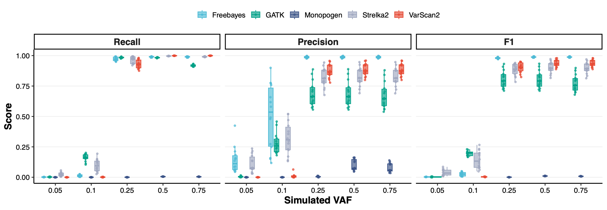
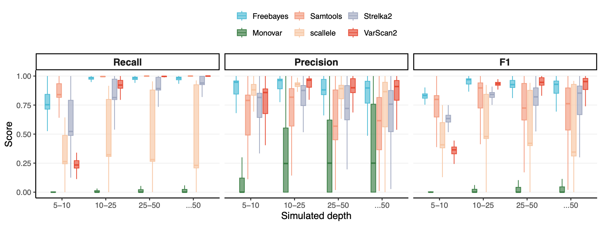

# Read-level simulations {#simulations}

Read-level simulations were performed by introducing synthetic SNVs directly into the original RNA-seq BAM files to evaluate variant calling performance across different variant allele frequencies (VAFs) and sequencing depths. Candidate sites were sampled from predefined genomic regions after excluding previously identified variants and their ±100 bp flanking regions. Eligible reads or fragments were selected based on alignment status and sequencing quality, and reference-supporting bases were modified according to the target VAF. Modified BAM files and corresponding ground-truth records were generated for downstream evaluation.

For VAF simulations, five target VAFs (0.05, 0.10, 0.25, 0.50, and 0.75) were evaluated at sequencing depths ≥40×, with 10,000 candidate sites for 10x Genomics and 3,000 for Smart-seq2. For depth simulations, a fixed VAF of 0.4 was used. The Smart-seq2 workflow sampled 50,000 candidate sites and selected up to 3,000 sites per effective-depth bin (5–9×, 10–24×, 25–49×, and ≥50×).

As the simulation procedures were similar across the two sequencing platforms, only the **10x Genomics VAF simulation** and **Smart-seq2 depth simulation** are presented below as representative workflows to avoid redundancy.

## 10x VAF simulation

<details>
<summary>simulation-region preparation</summary>

Step 1. Extract and merge protein-coding exon regions from the GTF annotation.

```{bash native-10x-simulation-region-preparation, eval=FALSE}
gtf="/home/tantingting/scmut/ref/refdata-gex-GRCh38-2024-A/genes/genes.gtf"
outdir="/mnt/storage/tantingting/scmut/simu/region"
mkdir -p "$outdir"

cat "$gtf" | awk 'BEGIN{OFS="\t"}
    $3=="exon" &&
    $0 ~ /gene_type "protein_coding"/ &&
    $1 ~ /^chr([1-9]|1[0-9]|2[0-2])$/ {
        print $1,$4-1,$5
    }' | bedtools sort -i - | bedtools merge -i - > "${outdir}/protein_coding_exon.merged.bed"

wc -l "${outdir}/protein_coding_exon.merged.bed"

awk '{sum+=$3-$2} END{print "Total exon length:",sum/1000000,"Mb"}' "${outdir}/protein_coding_exon.merged.bed"

head "${outdir}/protein_coding_exon.merged.bed"
```

Step 2. Intersect protein-coding exon regions with scRNA-seq regions covered at ≥10× for each sample.

```{bash, eval=FALSE}
samples=(Acral1 Acral2 Acral3pre Acral3post Acral4 Cutaneous1 Cutaneous1Lym Cutaneous2)

for sample in "${samples[@]}"
do
    INBED="/mnt/storage/tantingting/scmut/WES_gold/2_melanoma/region/whole/scRNA_${sample}_gt10_strict.bed"
    OUTBED="${OUTDIR}/${sample}.exon_gt10.bed"

    bedtools intersect -a $EXON_BED -b $INBED | bedtools sort -i - | bedtools merge -i - > $OUTBED

    n=$(wc -l < $OUTBED)

    mb=$(awk '
        {sum+=$3-$2}
        END{printf "%.2f",sum/1000000}
    ' $OUTBED)

    echo -e "melanoma\t${sample}\t${n}\t${mb}" >> ${OUTDIR}/summary.tsv
done
```

Step 3. Exclude sites identified by the union of six variant callers and their ±100 bp flanking regions to obtain the final simulation regions.

```{bash, eval=FALSE}
REGION_DIR="/mnt/storage/tantingting/scmut/simu/region/exon_gt10"
UNION_DIR="/mnt/storage/tantingting/scmut/simu/original_union_sites"
OUT_DIR="/mnt/storage/tantingting/scmut/simu/region/final_sim_region"
mkdir -p "$OUT_DIR"

echo -e "Sample\tN_region\tLength_Mb" > "${OUT_DIR}/final_region_summary.tsv"

for sample in P4_cSCC P5_cSCC P6_cSCC P7_cSCC P9_cSCC P10_cSCC Acral1 Acral2 Acral3pre Acral3post Acral4 Cutaneous1 Cutaneous1Lym Cutaneous2
do
    bedtools subtract -a "${REGION_DIR}/${sample}.exon_gt10.bed" \
      -b "${UNION_DIR}/${sample}.union_6tools.plusminus100bp.bed" | bedtools sort -i - | bedtools merge -i - \
    > "${OUT_DIR}/${sample}.final_sim_region.bed"

    n=$(wc -l < "${OUT_DIR}/${sample}.final_sim_region.bed")
    mb=$(awk '{sum+=$3-$2} END{printf "%.2f",sum/1000000}' "${OUT_DIR}/${sample}.final_sim_region.bed")

    echo -e "${sample}\t${n}\t${mb}" >> "${OUT_DIR}/final_region_summary.tsv"
done

column -t "${OUT_DIR}/final_region_summary.tsv"
```

</details>

<details>
<summary>VAF simulation code</summary>

```{bash, eval=FALSE}
REF=/home/tantingting/scmut/ref/bwa_ref/genome.fa
REGION_DIR=/mnt/storage/tantingting/scmut/simu/region/final_sim_region_dp40
OUTDIR=/mnt/storage/tantingting/scmut/simu/direct_spike_vaf_dp40_final

N_SITE=10000
FLANK=0
MINDEPTH=40
MINMUTREADS=2
THREADS=16
SEED=1234
VAFS=(0.05 0.1 0.25 0.5 0.75)

mkdir -p ${OUTDIR}/{scripts,sites,window,bam,log,truth,summary}
mkdir -p ${OUTDIR}/cache

#samples=(P4_cSCC)
#samples=(
#P4_cSCC P5_cSCC P6_cSCC P7_cSCC P9_cSCC P10_cSCC
#Acral1 Acral2 Acral3pre Acral3post Acral4 Cutaneous1 Cutaneous1Lym Cutaneous2
#)

samples=("$@")

if [[ ${#samples[@]} -eq 0 ]]; then
    echo "[ERROR] No sample specified"
    exit 1
fi

get_bam() {
    sample=$1
    case "$sample" in
        P*_cSCC) echo "/mnt/storage/tantingting/scmut/bam/1_cSCC_scRNA/${sample}/outs/${sample}_map.bam" ;;
        Acral1) echo "/mnt/storage/tantingting/scmut/bam/2_melanoma_scRNA/Acral1_SRR20791206/outs/Acral1_SRR20791206_map.bam" ;;
        Acral2) echo "/mnt/storage/tantingting/scmut/bam/2_melanoma_scRNA/Acral2_SRR20791205/outs/Acral2_SRR20791205_map.bam" ;;
        Acral3pre) echo "/mnt/storage/tantingting/scmut/bam/2_melanoma_scRNA/Acral3pre_SRR20791203/outs/Acral3pre_SRR20791203_map.bam" ;;
        Acral3post) echo "/mnt/storage/tantingting/scmut/bam/2_melanoma_scRNA/Acral3post_SRR20791202/outs/Acral3post_SRR20791202_map.bam" ;;
        Acral4) echo "/mnt/storage/tantingting/scmut/bam/2_melanoma_scRNA/Acral4_SRR20791201/outs/Acral4_SRR20791201_map.bam" ;;
        Cutaneous1) echo "/mnt/storage/tantingting/scmut/bam/2_melanoma_scRNA/Cutaneous1_SRR20791198/outs/Cutaneous1_SRR20791198_map.bam" ;;
        Cutaneous1Lym) echo "/mnt/storage/tantingting/scmut/bam/2_melanoma_scRNA/Cutaneous1Lym_SRR20791196/outs/Cutaneous1Lym_SRR20791196_map.bam" ;;
        Cutaneous2) echo "/mnt/storage/tantingting/scmut/bam/2_melanoma_scRNA/Cutaneous2_SRR20791197/outs/Cutaneous2_SRR20791197_map.bam" ;;
        *) echo "NA" ;;
    esac
}

############################################
# 1. Generate fixed master sites for each sample
############################################

cat > ${OUTDIR}/scripts/make_master_sites.py << 'PY'
import sys, random, subprocess, bisect
import os
import pickle

region_bed, ref, n_site, out, seed = sys.argv[1], sys.argv[2], int(sys.argv[3]), sys.argv[4], int(sys.argv[5])
random.seed(seed)
bases = ["A", "C", "G", "T"]
regions, cum = [], []
total = 0

with open(region_bed) as f:
    for line in f:
        if not line.strip() or line.startswith("#"):
            continue
        chrom, start, end = line.strip().split()[:3]
        start, end = int(start), int(end)
        if end <= start:
            continue
        total += end - start
        regions.append((chrom, start, end))
        cum.append(total)

if total == 0:
    sys.exit("No valid regions")

seen, tries, max_tries = set(), 0, n_site * 200

with open(out, "w") as w:
    while len(seen) < n_site and tries < max_tries:
        tries += 1
        i = bisect.bisect_left(cum, random.randint(1, total))
        chrom, start, end = regions[i]
        pos = random.randint(start, end - 1) + 1
        key = (chrom, pos)

        if key in seen:
            continue

        try:
            fa = subprocess.check_output(["samtools", "faidx", ref, f"{chrom}:{pos}-{pos}"], text=True).splitlines()
            ref_base = "".join(fa[1:]).upper()
        except Exception:
            continue

        if len(ref_base) != 1 or ref_base not in bases:
            continue

        alt = random.choice([b for b in bases if b != ref_base])
        seen.add(key)
        w.write(f"{chrom}\t{pos}\t{pos}\t{ref_base}\t{alt}\n")
PY

############################################
# 2. Direct spike-in script
# Key modifications: Instead of randomly modifying individual reads, fragments are first selected based on query_name. During the second BAM pass, both R1 and R2 sharing the same query_name are modified if they cover the target site.
############################################

cat > ${OUTDIR}/scripts/direct_spike_bam.py << 'PY'
import sys, random, pysam, math
import bisect
from collections import defaultdict
import os
import pickle
from collections import defaultdict

bam_in, sites_file, ref_fa, bam_out, truth_out, min_depth, min_mutreads, seed, cache_file = sys.argv[1:10]
min_depth, min_mutreads, seed = int(min_depth), int(min_mutreads), int(seed)
random.seed(seed)

bam = pysam.AlignmentFile(bam_in, "rb")

sites = []
with open(sites_file) as f:
    for line in f:
        if not line.strip() or line.startswith("#"):
            continue
        fs = line.strip().split()
        chrom, pos, end, vaf, ref_base, alt = fs[0], int(fs[1]), int(fs[2]), float(fs[3]), fs[4].upper(), fs[5].upper()
        sites.append((chrom, pos, vaf, ref_base, alt))
sites.sort(key=lambda x: (x[0], x[1]))

# fragment_edit_map:
#   key = (chrom, pos, query_name)
#   value = alt

fragment_edit_map = {}
truth = []


############################################
# Optimization 1: Group sites by chromosome
# Optimization 2: Compute aligned_pairs only once per read
# Optimization 3: Collect candidate fragments for each site
############################################

if os.path.exists(cache_file):

    print(
        f"[INFO] load cache: {cache_file}",
        file=sys.stderr
    )

    with open(cache_file, "rb") as f:
        site_info = pickle.load(f)

    for chrom, pos, vaf, ref_base, alt in sites:

        if (chrom, pos) not in site_info:
            continue

        site_info[(chrom, pos)]["vaf"] = vaf

else:

    print(
        f"[INFO] build cache: {cache_file}",
        file=sys.stderr
    )
    site_info = {}

    # Build the site information table
    for chrom, pos, vaf, ref_base, alt in sites:
        site_info[(chrom, pos)] = {
            "vaf": vaf,
            "ref": ref_base,
            "alt": alt,
            "cover": 0,
            "candidates": set()
        }
    chr_sites = defaultdict(set)

    for chrom, pos, vaf, ref_base, alt in sites:
        chr_sites[chrom].add(pos)

    print(
        f"[INFO] {len(site_info)} sites loaded",
        file=sys.stderr
    )

############################################
# Batch scan by chromosome
############################################

    for chrom in sorted(chr_sites.keys()):

        target_pos = sorted(chr_sites[chrom])

        # pysam.fetch() uses 0-based, half-open intervals [start, end)
        start = min(target_pos) - 1
        end = max(target_pos)+1

        print(
            f"[INFO] scanning {chrom}",
            file=sys.stderr
        )

        try:
            iterator = bam.fetch(chrom, start, end)
        except ValueError:
            continue

        n_read = 0

        for r in iterator:

            if r.is_unmapped:
                continue

            if r.is_secondary:
                continue

            if r.is_supplementary:
                continue

            seq = r.query_sequence

            if seq is None:
                continue

            n_read += 1

            aligned = {
                rp + 1: qp
                for qp, rp in r.get_aligned_pairs(matches_only=False)
                if qp is not None and rp is not None
            }

            if not aligned:
                continue

        #read_start = min(aligned)
        #read_end = max(aligned)
        #1-based genomic position
            read_start = r.reference_start + 1
            read_end = r.reference_end
            if read_end is None:
                continue

        ####################################
        # Find target sites covered by the current read
        ####################################

            left = bisect.bisect_left(
                target_pos,
                read_start
            )

            right = bisect.bisect_right(
                target_pos,
                read_end
            )

            covered_sites = target_pos[left:right]

            if not covered_sites:
                continue

            for pos in covered_sites:

                qp = aligned.get(pos)

                if qp is None:
                    continue

                base = seq[qp].upper()

                if base not in "ACGT":
                    continue

                info = site_info[(chrom, pos)]

                info["cover"] += 1

                if base == info["ref"]:
                    info["candidates"].add(
                        r.query_name
                    )

        print(
            f"[INFO] {chrom}: {n_read} reads scanned",
            file=sys.stderr
        )
        
##################################################
# Save the cache after the first scan
##################################################

    with open(cache_file, "wb") as f:
        pickle.dump(site_info, f)
    print(
        f"[INFO] cache saved: {cache_file}",
        file=sys.stderr
    )

############################################
# Select fragments to modify based on coverage depth and VAF
############################################

fragment_edit_map = {}
truth = []

for (chrom, pos), info in site_info.items():

    dp = info["cover"]

    if dp < min_depth:
        continue

    candidates = list(
        info["candidates"]
    )

    if len(candidates) == 0:
        continue

    target_alt_reads = max(
        min_mutreads,
        math.ceil(dp * info["vaf"])
    )

    n_choose = min(
        len(candidates),
        target_alt_reads
    )

    chosen_names = random.sample(
        candidates,
        n_choose
    )

    for name in chosen_names:
        fragment_edit_map[
            (chrom, pos, name)
        ] = info["alt"]

    truth.append(
        (
            chrom,
            pos,
            info["ref"],
            info["alt"],
            dp,
            len(candidates),
            n_choose,
            "NA"
        )
    )


print(
    f"[INFO] fragment_edit_map={len(fragment_edit_map)}",
    file=sys.stderr
)

############################################
# Second pass: Reopen the BAM and write reads sequentially
#
#   First, check query_name to identify reads requiring modification.
#   Compute aligned_pairs only for selected fragments.
#   This allows most unmodified reads to be written directly.
############################################

bam.close()
bam = pysam.AlignmentFile(bam_in, "rb")
out = pysam.AlignmentFile(bam_out, "wb", template=bam)

edited_reads = 0
edited_bases = 0
site_edited_bases = defaultdict(int)

edit_by_qname = defaultdict(lambda: defaultdict(dict))

for chrom, pos, qname in fragment_edit_map:
    alt = fragment_edit_map[(chrom, pos, qname)]
    edit_by_qname[qname][chrom][pos] = alt

print(
    f"[INFO] edit_by_qname={len(edit_by_qname)}",
    file=sys.stderr
)

for r in bam:

    if r.is_unmapped or r.is_secondary or r.is_supplementary or r.query_sequence is None:
        out.write(r)
        continue

    qname = r.query_name

    if qname not in edit_by_qname:
        out.write(r)
        continue

    chrom = r.reference_name

    if chrom is None:
        out.write(r)
        continue

    if chrom not in edit_by_qname[qname]:
        out.write(r)
        continue

    target_edits = edit_by_qname[qname][chrom]

    seq = list(r.query_sequence)
    quals = r.query_qualities
    changed = 0

    ########################################
    # Compute aligned_pairs only for reads that may require modification
    ########################################

    for qp, rp in r.get_aligned_pairs(matches_only=False):

        if qp is None or rp is None:
            continue

        pos = rp + 1

        if pos not in target_edits:
            continue

        alt = target_edits[pos]

        if qp < len(seq) and seq[qp].upper() in "ACGT" and seq[qp].upper() != alt:
            seq[qp] = alt
            changed += 1
            site_edited_bases[(chrom, pos)] += 1

    if changed > 0:
        r.query_sequence = "".join(seq)
        r.query_qualities = quals
        edited_reads += 1
        edited_bases += changed

    out.write(r)

out.close()
bam.close()

############################################
# Output ground truth
# mut_reads_planned = Number of selected query_names
# mut_bases_edited = Number of read bases actually modified
# real_vaf = mut_bases_edited / dp
############################################

with open(truth_out, "w") as w:
    w.write("chrom\tpos\tref\talt\tdp\tcandidate_fragments\tmut_fragments_planned\tmut_bases_edited\treal_vaf\n")
    for chrom, pos, ref_base, alt, dp, n_candidate, n_choose, _ in truth:
        mut_bases = site_edited_bases.get((chrom, pos), 0)
        real_vaf = mut_bases / dp if dp > 0 else 0
        w.write("\t".join(map(str, [chrom, pos, ref_base, alt, dp, n_candidate, n_choose, mut_bases, real_vaf])) + "\n")

sys.stderr.write(f"[INFO] sites_input={len(sites)} truth_sites={len(truth)} edited_reads={edited_reads} edited_bases={edited_bases}\n")
PY

manifest=${OUTDIR}/summary/prepare_manifest.tsv

if [[ ! -s ${manifest} ]]; then
    echo -e "Sample\tMode\tVAF\tMasterSites\tSites\tWindowBed\tOriginalSubsetBam\tSpikeinBam\tCalmdBam\tTruth" > ${manifest}
fi

############################################
# 3. Main loop
############################################

for sample in "${samples[@]}"; do
    echo "========== ${sample} =========="

    bam=$(get_bam ${sample})
    region_bed=${REGION_DIR}/${sample}.final_sim_region_dp40.bed
    master_sites=${OUTDIR}/sites/${sample}.master_sites.txt
    sample_window=${OUTDIR}/window/${sample}.master.window.bed
    sample_subset=${OUTDIR}/bam/${sample}.master.original_subset.bam

    [[ "${bam}" != "NA" ]] || { echo "[SKIP] unknown sample: ${sample}"; continue; }
    [[ -f ${region_bed} ]] || { echo "[SKIP] no region: ${region_bed}"; continue; }
    [[ -f ${bam} ]] || { echo "[SKIP] no bam: ${bam}"; continue; }
    [[ -f ${bam}.bai ]] || samtools index ${bam}

    if [[ -s ${master_sites} ]]; then
        echo "[1] master sites exists, skip: ${master_sites}"
    else
        echo "[1] make master sites"
        python ${OUTDIR}/scripts/make_master_sites.py ${region_bed} ${REF} ${N_SITE} ${master_sites} ${SEED}
    fi

    n_master=$(wc -l < ${master_sites})
    echo "[INFO] master sites: ${n_master}"
    [[ ${n_master} -gt 0 ]] || { echo "[SKIP] no master sites: ${sample}"; continue; }

    if [[ -s ${sample_window} ]]; then
        echo "[2] master window exists, skip: ${sample_window}"
    else
        echo "[2] make master window"
        awk -v OFS="\t" -v flank=${FLANK} '{s=$2-1-flank; e=$3+flank; if(s<0)s=0; print $1,s,e}' ${master_sites} \
            | sort -k1,1 -k2,2n | bedtools merge > ${sample_window}
    fi

    if [[ -s ${sample_subset} && -s ${sample_subset}.bai ]]; then
        echo "[3] master subset BAM exists, skip: ${sample_subset}"
    else
        echo "[3] subset BAM once"
        samtools view -@ ${THREADS} -P -b -L ${sample_window} ${bam} > ${sample_subset}
        samtools index ${sample_subset}
    fi

    for vaf in "${VAFS[@]}"; do
        tag=${sample}.vaf${vaf}
        cache=${OUTDIR}/cache/${sample}.site_info.pkl
        sites=${OUTDIR}/sites/${tag}.sites.txt
        spikein=${OUTDIR}/bam/${tag}.spikein.bam
        spikein_sorted=${OUTDIR}/bam/${tag}.spikein.sorted.bam
        spikein_calmd=${OUTDIR}/bam/${tag}.spikein.sorted.calmd.bam
        truth=${OUTDIR}/truth/${tag}.truth.tsv

        echo "[4] ${sample} VAF=${vaf}"

        if [[ -s ${sites} ]]; then
            echo "[4] sites exists, skip: ${sites}"
        else
            awk -v OFS="\t" -v vaf=${vaf} '{print $1,$2,$3,vaf,$4,$5}' ${master_sites} > ${sites}
        fi

        if [[ -s ${spikein_calmd} && -s ${spikein_calmd}.bai && -s ${truth} ]]; then
            echo "[5] calmd spike-in BAM exists, skip: ${spikein_calmd}"
        else
            echo "[5] direct spike-in BAM"
            python ${OUTDIR}/scripts/direct_spike_bam.py ${sample_subset} ${sites} ${REF} ${spikein} \
                ${truth} ${MINDEPTH} ${MINMUTREADS} ${SEED} ${cache} > ${OUTDIR}/log/${tag}.log 2>&1

            [[ -s ${spikein} ]] || { echo "[ERROR] direct spike-in failed: check ${OUTDIR}/log/${tag}.log"; continue; }

            echo "[6] sort/index"
            samtools sort -@ ${THREADS} -o ${spikein_sorted} ${spikein}
            samtools index ${spikein_sorted}
            samtools quickcheck ${spikein_sorted}

            echo "[7] calmd/index"
            samtools calmd -@ ${THREADS} -b ${spikein_sorted} ${REF} > ${spikein_calmd}
            samtools index ${spikein_calmd}
            samtools quickcheck ${spikein_calmd}
        fi

        n_truth=$(($(wc -l < ${truth}) - 1))
        echo "[INFO] truth sites: ${n_truth}"

        if ! awk -v s="${sample}" -v v="${vaf}" '$1==s && $2=="VAF" && $3==v{found=1} END{exit found?0:1}' ${manifest}; then
            echo -e "${sample}\tVAF\t${vaf}\t${master_sites}\t${sites}\t${sample_window}\t${sample_subset}\t${spikein_sorted}\t${spikein_calmd}\t${truth}" >> ${manifest}
        fi
    done

    echo "[DONE] ${sample}"
done
```
</details>


<details>
<summary>VAF simulation plotting</summary>

```{r native-10x-vaf-simulation-plotting, eval=FALSE}
suppressPackageStartupMessages({
  library(data.table)
  library(dplyr)
  library(ggplot2)
  library(stringr)
  library(R.utils)
})

base_dir <- "/mnt/storage/tantingting/scmut/simu/direct_spike_vaf_dp40_final"
truth_dir <- file.path(base_dir, "truth")
vcf_dir <- file.path(base_dir, "caller/newonly")
out_dir <- file.path(base_dir, "performance_plot")
dir.create(out_dir, recursive = TRUE, showWarnings = FALSE)

tools <- c("Freebayes", "GATK", "Monopogen", "Strelka2", "VarScan2")
vafs <- c("0.05", "0.1", "0.25", "0.5", "0.75")

truth_files <- list.files(truth_dir, pattern = "\\.truth\\.tsv$", full.names = FALSE)
samples <- sort(unique(sub("\\.vaf.*$", "", truth_files)))

read_truth <- function(f) {
  x <- fread(f)
  names(x) <- str_replace_all(names(x), "^#", "")
  x[, chrom := as.character(chrom)]
  x[, pos := as.integer(pos)]
  x[, ref := toupper(as.character(ref))]
  x[, alt := toupper(as.character(alt))]
  unique(x[, .(chrom, pos, ref, alt)])
}

read_vcf <- function(f) {
  if (!file.exists(f))
  return(data.table(chrom = character(), pos = integer(), ref = character(), alt = character()))
  x <- tryCatch(fread(cmd = paste("bcftools query -f '%CHROM\\t%POS\\t%REF\\t%ALT\\n'", shQuote(f))), error = function(e) data.table())
  if (nrow(x) == 0)
  return(data.table(chrom = character(), pos = integer(), ref = character(), alt = character()))
  setnames(x, c("chrom", "pos", "ref", "alt"))
  x[, chrom := as.character(chrom)]
  x[, pos := as.integer(pos)]
  x[, ref := toupper(as.character(ref))]
  x[, alt := toupper(as.character(alt))]
  x <- x[nchar(ref) == 1 & nchar(alt) == 1]
  unique(x[, .(chrom, pos, ref, alt)])
}

res <- list()
k <- 1

for (sample in samples) {
  for (vaf in vafs) {
    truth_file <- file.path(truth_dir, paste0(sample, ".vaf", vaf, ".truth.tsv"))
    if (!file.exists(truth_file))
    next
    truth <- read_truth(truth_file)
    truth_key <- paste(truth$chrom, truth$pos, truth$ref, truth$alt, sep = ":")

    for (tool in tools) {
      vcf_file <- file.path(vcf_dir, paste0(sample, ".vaf", vaf, ".", tool, ".newonly.vcf.gz"))
      call <- read_vcf(vcf_file)
      call_key <- paste(call$chrom, call$pos, call$ref, call$alt, sep = ":")

      tp <- sum(call_key %in% truth_key)
      fp <- sum(!call_key %in% truth_key)
      fn <- sum(!truth_key %in% call_key)

      precision <- ifelse(tp + fp > 0, tp/(tp + fp), NA_real_)
      recall <- ifelse(tp + fn > 0, tp/(tp + fn), NA_real_)
      f1 <- ifelse(!is.na(precision + recall) & precision + recall > 0, 2 * precision * recall/(precision +
        recall), NA_real_)

      res[[k]] <- data.table(sample = sample, vaf = as.numeric(vaf), tool = tool, truth_n = length(truth_key),
        call_n = length(call_key), TP = tp, FP = fp, FN = fn, Precision = precision, Recall = recall, F1 = f1)
      k <- k + 1
    }
  }
}

perf <- rbindlist(res)
perf[, tool := factor(tool, levels = tools)]
perf[, vaf_label := factor(vaf, levels = as.numeric(vafs), labels = vafs)]

fwrite(perf, file.path(out_dir, "vaf_performance_summary.tsv"), sep = "\t")

tool_cols <- c(Freebayes = "#1F78B4", GATK = "#33A02C", Monopogen = "#6A3D9A", Strelka2 = "#B15928", VarScan2 = "#E31A1C")

plot_metric <- function(metric) {
  p <- ggplot(perf, aes(x = vaf_label, y = .data[[metric]], fill = tool, color = tool)) +
    geom_boxplot(outlier.shape = NA,
      width = 0.65, position = position_dodge(width = 0.8), alpha = 0.65) +
    geom_point(position = position_jitterdodge(jitter.width = 0.12,
      dodge.width = 0.8), size = 1.4, alpha = 0.75) +
    scale_fill_manual(values = tool_cols) +
    scale_color_manual(values = tool_cols) +
    scale_y_continuous(limits = c(0, 1), breaks = seq(0, 1, 0.25)) +
    labs(x = "Simulated VAF", y = metric,
      fill = NULL, color = NULL) +
    theme_classic(base_size = 14) +
    theme(axis.text.x = element_text(size = 12,
      color = "black"), axis.text.y = element_text(size = 12, color = "black"), axis.title = element_text(size = 15,
        color = "black", face = "bold"), legend.position = "top", legend.text = element_text(size = 11), panel.grid.major.y = element_line(color = "grey90",
          linewidth = 0.3))
  ggsave(file.path(out_dir, paste0("VAF_", metric, "_boxplot.pdf")), p, width = 7.5, height = 4.8)
  ggsave(file.path(out_dir, paste0("VAF_", metric, "_boxplot.png")), p, width = 7.5, height = 4.8, dpi = 300)
}

plot_metric("Recall")
plot_metric("Precision")
plot_metric("F1")

perf_long <- melt(perf, id.vars = c("sample", "vaf", "vaf_label", "tool", "truth_n", "call_n", "TP", "FP", "FN"),
  measure.vars = c("Recall", "Precision", "F1"), variable.name = "Metric", value.name = "Score")

p_all <- ggplot(perf_long, aes(x = vaf_label, y = Score, fill = tool, color = tool)) +
  geom_boxplot(outlier.shape = NA,
    width = 0.65, position = position_dodge(width = 0.8), alpha = 0.65) +
  geom_point(position = position_jitterdodge(jitter.width = 0.12,
    dodge.width = 0.8), size = 1.1, alpha = 0.7) +
  facet_wrap(~Metric, nrow = 1) +
  scale_fill_manual(values = tool_cols) +
  scale_color_manual(values = tool_cols) +
  scale_y_continuous(limits = c(0, 1), breaks = seq(0, 1, 0.25)) +
  labs(x = "Simulated VAF",
    y = "Score", fill = NULL, color = NULL) +
  theme_classic(base_size = 14) +
  theme(axis.text.x = element_text(size = 11,
    color = "black"), axis.text.y = element_text(size = 11, color = "black"), axis.title = element_text(size = 15,
      color = "black", face = "bold"), strip.text = element_text(size = 14, face = "bold"), legend.position = "top",
    legend.text = element_text(size = 11), panel.grid.major.y = element_line(color = "grey90", linewidth = 0.3))

ggsave(file.path(out_dir, "VAF_Recall_Precision_F1_boxplot.pdf"), p_all, width = 12, height = 4.5)
ggsave(file.path(out_dir, "VAF_Recall_Precision_F1_boxplot.png"), p_all, width = 12, height = 4.5, dpi = 300)

message("[DONE] output: ", out_dir)
```

</details>

```{r,  echo=FALSE , out.width = "600px",fig.align = 'center',  fig.cap ='Precision, recall, and F1-score of five variant callers evaluated using spike-in simulations across different simulated VAFs. For each sample, approximately 10,000 synthetic SNVs were introduced into regions with sequencing depth ≥40X for each condition.' , out.width='100%', fig.show='hold'}
library(knitr)


```

## Smart-seq2 DP simulation

<details>
<summary>simulation-region preparation</summary>


```{bash, eval=FALSE}
BASE="/mnt/storage/tantingting/scmut_smart"
MANIFEST="${BASE}/bam/star_qc_unique_ge10k_scrna_sample_wes.tsv"
# Protein-coding exon regions
EXON_BED="/mnt/storage/tantingting/scmut/simu/region/protein_coding_exon.merged.bed"
# Precomputed scRNA-seq regions with DP >= 1
SCRNA_GE1_BASE="${BASE}/WES_gold/smartseq_callable"
# Precomputed union sites from seven callers with ±100 bp flanking regions
UNION_DIR="${BASE}/simu/union_sites"

OUT_DIR="${BASE}/simu/region/dp_sim_region"
mkdir -p "$OUT_DIR"

echo -e "Sample\tSRR\tWES_SRR\tDataset\tN_region\tLength_bp\tLength_Mb" \
> "${OUT_DIR}/final_region_summary.tsv"

tail -n +2 "$MANIFEST" |
while read -r scRNA_SRR sample WES_SRR
do
    [[ -n "$scRNA_SRR" && -n "$sample" ]] || continue

    # Determine the dataset based on the sample ID
    if [[ "$sample" == PT* ]]; then
        DATASET="1_TNBC"
        SCRNA_GE1_DIR="${SCRNA_GE1_BASE}/TNBC/scrna_ge1"
    elif [[ "$sample" == BC* ]]; then
        DATASET="2_BRCA"
        SCRNA_GE1_DIR="${SCRNA_GE1_BASE}/BRCA/scrna_ge1"
    else
        echo "[WARN] skip $sample $scRNA_SRR"
        continue
    fi

    echo "=============================="
    echo "[INFO] Sample : $sample"
    echo "[INFO] SRR    : $scRNA_SRR"
    echo "[INFO] Dataset: $DATASET"

    # Input files
    scrna_bed="${SCRNA_GE1_DIR}/${scRNA_SRR}_scRNA_ge1.bed"
    union_bed="${UNION_DIR}/${scRNA_SRR}.union_7tools.plusminus100bp.bed"
    final_bed="${OUT_DIR}/${scRNA_SRR}.final_sim_region_ge1.bed"

    if [[ ! -s "$scrna_bed" ]]; then
        echo "[WARN] missing scRNA ge1: $scrna_bed"
        continue
    fi
    if [[ ! -s "$union_bed" ]]; then
        echo "[WARN] missing union: $union_bed"
        continue
    fi

    # Intersect exon regions with scRNA-seq DP >= 1 regions
    intersect_bed="${OUT_DIR}/${scRNA_SRR}.exon_ge1.tmp.bed"
    bedtools intersect \
        -a "$EXON_BED" \
        -b "$scrna_bed" \
        -wa -u |
        bedtools sort -i - |
        bedtools merge -i - > "$intersect_bed"

    # Exclude union sites and their ±100 bp flanking regions
    bedtools subtract \
        -a "$intersect_bed" \
        -b "$union_bed" |
        bedtools sort -i - |
        bedtools merge -i - > "$final_bed"

    rm -f "$intersect_bed"

    # Summarize the final simulation regions
    n_region=$(wc -l < "$final_bed")
    length_bp=$(awk '{sum += $3-$2} END{print sum+0}' "$final_bed")
    length_mb=$(awk '{sum += $3-$2} END{printf "%.4f",sum/1000000}' "$final_bed")

    echo -e \
"${sample}\t${scRNA_SRR}\t${WES_SRR}\t${DATASET}\t${n_region}\t${length_bp}\t${length_mb}" \
>> "${OUT_DIR}/final_region_summary.tsv"

    echo "[INFO] Final regions: $n_region"
    echo "[INFO] Length       : ${length_mb} Mb"
done

echo "=============================="
echo "[INFO] Finished"
column -t -s $'\t' "${OUT_DIR}/final_region_summary.tsv"
```

</details>

<details>
<summary>DP simulation code</summary>


```{bash, eval=FALSE}
#!/bin/bash

# Smart-seq2 DP effective-bin simulation
#
# 1. Randomly generate 50,000 candidate sites from Smart-seq2 callable regions with DP >= 1
# 2. Scan the BAM to calculate effective DP: Q>=20, A/C/G/T base, remove duplicate/secondary/supplementary/qcfail
# 3. Assign sites to mutually exclusive effective-DP bins: DP5-10, DP10-25, DP25-50,DP>=50
# 4. Simulate up to 3,000 sites per bin
# 5. Perform direct spike-in at a fixed VAF of 0.4

REF=/home/tantingting/scmut/ref/bwa_ref/genome.fa
OUTDIR=/mnt/storage/tantingting/scmut_smart/simu/direct_spike_dp_effbin_q20_vaf04_final
MANIFEST=/mnt/storage/tantingting/scmut_smart/bam/star_qc_unique_ge10k_scrna_sample_wes.tsv
REGION_DIR=/mnt/storage/tantingting/scmut_smart/simu/region/dp_sim_region

N_CANDIDATE=50000
FLANK=0
FIXED_VAF=0.4
N_SITE=3000
MINMUTREADS=2
THREADS=16
SEED=1234
MIN_BQ=20
MIN_MQ=0

DP_BINS=("5_10" "10_25" "25_50" "50plus")

mkdir -p ${OUTDIR}/{scripts,sites,window,bam,cache,truth,log,summary}

samples=("$@")
if [[ ${#samples[@]} -eq 0 ]]; then
    echo "[ERROR] No sample specified"
    exit 1
fi

get_bam(){

    srr=$1

    sample=$(awk -v s="$srr" '$1==s{print $2}' ${MANIFEST})

    if [[ $sample == PT* ]]; then
        echo "/mnt/storage/tantingting/scmut_smart/bam/1_TNBC_scRNA/md_bam/${srr}_sortmd.bam"
    elif [[ $sample == BC* ]]; then
        echo "/mnt/storage/tantingting/scmut_smart/bam/2_BRCA_scRNA/md_bam/${srr}_sortmd.bam"
    else
        echo "NA"
    fi
}

###########################################################
# Step 1:Randomly generate candidate variant sites from Smart-seq2 callable regions
#
# Input: final_sim_region_ge1.bed
#
# Procedure:
# 1. Randomly select genomic positions within callable regions
# 2. Retrieve the reference allele from the reference genome
# 3. Randomly generate an alternative allele
#
# Output: candidate_sites.txt
#
# Note:
# Candidate sites are not the final simulated variants; they are subsequently filtered based on the actual effective DP.
###########################################################

cat > ${OUTDIR}/scripts/make_candidate_sites.py << 'PY'
import sys, random, subprocess, bisect

region_bed, ref, n_site, out, seed = (
    sys.argv[1],
    sys.argv[2],
    int(sys.argv[3]),
    sys.argv[4],
    int(sys.argv[5])
)

random.seed(seed)
bases=["A","C","G","T"]

regions=[]
cum=[]
total=0

with open(region_bed) as f:
    for line in f:
        if not line.strip() or line.startswith("#"):
            continue

        chrom,start,end=line.strip().split()[:3]
        start=int(start)
        end=int(end)

        if end<=start:
            continue

        total += end-start
        regions.append((chrom,start,end))
        cum.append(total)

seen=set()

with open(out,"w") as w:
    tries=0
    max_tries=n_site*300
    while len(seen)<n_site and tries<max_tries:
        tries+=1
        idx=bisect.bisect_left(
            cum,
            random.randint(1,total)
        )

        chrom,start,end=regions[idx]
        pos=random.randint(start,end-1)+1
        if (chrom,pos) in seen:
            continue
        try:
            fa=subprocess.check_output(
                [
                    "samtools",
                    "faidx",
                    ref,
                    f"{chrom}:{pos}-{pos}"
                ],
                text=True
            ).splitlines()
            ref_base="".join(fa[1:]).upper()
        except:
            continue
        if ref_base not in bases:
            continue
        alt=random.choice(
            [x for x in bases if x!=ref_base]
        )
        seen.add((chrom,pos))
        w.write(
            f"{chrom}\t{pos}\t{pos}\t{ref_base}\t{alt}\n"
        )

print(
    f"[INFO] candidate sites generated: {len(seen)}",
    file=sys.stderr
)
PY


###########################################################
# Step 2: Calculate the actual effective sequencing depth at candidate sites
#
# Purpose: Determine the number of reads eligible for simulation at each site using the original Smart-seq2 BAM.
#
# A read contributes to effective DP only if:
# 1. The read is mapped
# 2. It is not a secondary alignment
# 3. It is not a supplementary alignment
# 4. It is not marked as a duplicate
# 5. It has not failed QC
#   6. Mapping quality >= MIN_MQ
#   7. Base quality >= MIN_BQ
# 8. The aligned base is A/C/G/T
#
# The output cache contains:
#   ref
#   alt
# effective_dp: Number of A/C/G/T bases aligned to this site with BQ >= MIN_BQ
# ref_count: Number of bases matching the reference allele among effective-DP observations
# candidate_fragments: Set of query names eligible for conversion to alt; only reads/fragments with base == ref and BQ >= MIN_BQ are recorded
###########################################################


cat > ${OUTDIR}/scripts/build_effective_cache.py << 'PY'
import sys
import pysam
import pickle
from collections import defaultdict

bam_file=sys.argv[1]
candidate_file=sys.argv[2]
out_cache=sys.argv[3]

MIN_BQ=int(sys.argv[4])
MIN_MQ=int(sys.argv[5])

sites={}
chr_sites=defaultdict(set)

with open(candidate_file) as f:
    for line in f:
        chrom,pos,end,ref,alt=line.strip().split()
        pos=int(pos)
        sites[(chrom,pos)]={
            "ref":ref,
            "alt":alt,
            "effective_dp":0,
            "ref_count":0,
            "candidate_fragments":set()
        }
        chr_sites[chrom].add(pos)

bam=pysam.AlignmentFile(
    bam_file,
    "rb"
)
for chrom in chr_sites:
    positions=sorted(chr_sites[chrom])
    pos_set=set(positions)
    print(
        f"[INFO] scanning {chrom}",
        file=sys.stderr
    )
    try:
        reads=bam.fetch(
            chrom,
            min(positions)-1,
            max(positions)
        )
    except:
        continue
    for r in reads:
        if (
            r.is_unmapped
            or r.is_secondary
            or r.is_supplementary
            or r.is_duplicate
            or r.is_qcfail
        ):
            continue
        if r.mapping_quality < MIN_MQ:
            continue
        if (
            r.query_sequence is None
            or r.query_qualities is None
        ):
            continue
        seq=r.query_sequence
        qual=r.query_qualities

        for qp,rp in r.get_aligned_pairs(
            matches_only=False
        ):
            if qp is None or rp is None:
                continue
            pos=rp+1
            if pos not in pos_set:
                continue
            if qual[qp] < MIN_BQ:
                continue
            base=seq[qp].upper()
            if base not in "ACGT":
                continue
            info=sites[(chrom,pos)]
            info["effective_dp"] += 1
            if base == info["ref"]:
                info["ref_count"] += 1
                info["candidate_fragments"].add(
                    r.query_name
                )
bam.close()
with open(out_cache,"wb") as f:

    pickle.dump(
        sites,
        f,
        protocol=pickle.HIGHEST_PROTOCOL
    )
print(
    f"[INFO] saved {out_cache}",
    file=sys.stderr
)
for label,func in [
    ("DP1plus",
     lambda x:x["effective_dp"]>=1),
    ("DP5plus",
     lambda x:x["effective_dp"]>=5),
    ("DP10plus",
     lambda x:x["effective_dp"]>=10),
    ("DP25plus",
     lambda x:x["effective_dp"]>=25),
    ("DP50plus",
     lambda x:x["effective_dp"]>=50),
]:
    print(
        label,
        sum(
            func(x)
            for x in sites.values()
        ),
        file=sys.stderr
    )
PY

###########################################################
# Python 2: select_sites_by_effbin.py
#
# Function:
# Select sites from the effective cache by mutually exclusive DP bins
#
# Criteria:
# 1. effective_dp falls within the corresponding interval
#   2. candidate_fragments >= ceil(effective_dp * VAF)
#
# The second criterion is important:
# Insufficient reference-supporting reads prevent the target VAF of 0.4 from being achieved
###########################################################

cat > ${OUTDIR}/scripts/select_sites_by_effbin.py << 'PY'
import sys, pickle, random, math

cache_file, dp_bin, n_site, vaf, min_mutreads, out, seed = sys.argv[1:8]
n_site = int(n_site)
vaf = float(vaf)
min_mutreads = int(min_mutreads)
seed = int(seed)
random.seed(seed)

if dp_bin == "5_10":
    lo, hi = 5,10
elif dp_bin == "10_25":
    lo, hi = 10,25
elif dp_bin == "25_50":
    lo, hi = 25,50
elif dp_bin == "50plus":
    lo, hi = 50,None
else:
    sys.exit(f"Unknown dp_bin: {dp_bin}")

with open(cache_file, "rb") as f:
    cache = pickle.load(f)

eligible = []

for (chrom, pos), info in cache.items():
    dp = info["effective_dp"]
    ref_count = info["ref_count"]
    n_candidate = len(info["candidate_fragments"])
    need_alt = max(min_mutreads, math.ceil(dp * vaf))

    in_bin = dp >= lo if hi is None else lo <= dp < hi

    if in_bin and n_candidate >= need_alt:
        eligible.append((chrom, pos, info["ref"], info["alt"], dp, ref_count, n_candidate, need_alt))

eligible.sort(key=lambda x: (x[0], x[1]))

print(f"[INFO] {dp_bin} eligible={len(eligible)}", file=sys.stderr)

if len(eligible) == 0:
    sys.exit(f"No eligible sites for {dp_bin}")

if len(eligible) > n_site:
    selected = random.sample(eligible, n_site)
    selected.sort(key=lambda x: (x[0], x[1]))
else:
    selected = eligible
    print(f"[WARN] eligible < N_SITE, use all: {len(selected)}", file=sys.stderr)

with open(out, "w") as w:
    for chrom, pos, ref, alt, dp, ref_count, n_candidate, need_alt in selected:
        # chrom pos end vaf ref alt effective_dp_q20 ref_count_q20 candidate_fragments_q20 need_alt dp_bin
        w.write(f"{chrom}\t{pos}\t{pos}\t{vaf}\t{ref}\t{alt}\t{dp}\t{ref_count}\t{n_candidate}\t{need_alt}\t{dp_bin}\n")

print(f"[INFO] selected={len(selected)}", file=sys.stderr)
PY

###########################################################
# Python 3: direct_spike_from_effective_cache.py
#
# Function:
# Perform direct spike-in on the BAM using selected sites and the effective cache
#
# Logic:
# 1. Modify need_alt candidate fragments at each site
# 2. Candidate fragments have already been restricted during build_effective_cache to:
# base == ref and BQ >= MIN_BQ
# 3. The second pass that edits the BAM also requires BQ >= MIN_BQ
# This keeps effective_dp_q20 and mut_bases_edited in the truth file consistent
#
# Truth output:
#   effective_dp_q20
#   ref_count_q20
#   candidate_fragments_q20
#   mut_fragments_planned
#   mut_bases_edited
#   real_vaf = mut_bases_edited / effective_dp_q20
###########################################################

cat > ${OUTDIR}/scripts/direct_spike_from_effective_cache.py << 'PY'
import sys, random, pysam, pickle
from collections import defaultdict

bam_in, sites_file, bam_out, truth_out, seed, cache_file, min_bq = sys.argv[1:8]
seed = int(seed)
min_bq = int(min_bq)
random.seed(seed)

with open(cache_file, "rb") as f:
    cache = pickle.load(f)

sites = []
with open(sites_file) as f:
    for line in f:
        if not line.strip() or line.startswith("#"):
            continue
        fs = line.strip().split()
        chrom = fs[0]
        pos = int(fs[1])
        vaf = float(fs[3])
        ref = fs[4].upper()
        alt = fs[5].upper()
        dp = int(fs[6])
        ref_count = int(fs[7])
        n_candidate = int(fs[8])
        need_alt = int(fs[9])
        dp_bin = fs[10]
        sites.append((chrom, pos, vaf, ref, alt, dp, ref_count, n_candidate, need_alt, dp_bin))

fragment_edit_map = {}
truth = []

for chrom, pos, vaf, ref, alt, dp, ref_count, n_candidate, need_alt, dp_bin in sites:
    info = cache.get((chrom, pos))
    if info is None:
        continue

    candidates = list(info["candidate_fragments"])
    if len(candidates) < need_alt:
        continue

    chosen = random.sample(candidates, need_alt)

    for qname in chosen:
        fragment_edit_map[(chrom, pos, qname)] = alt

    truth.append((chrom, pos, ref, alt, dp, ref_count, len(candidates), need_alt, dp_bin))

edit_by_qname = defaultdict(lambda: defaultdict(dict))
for chrom, pos, qname in fragment_edit_map:
    edit_by_qname[qname][chrom][pos] = fragment_edit_map[(chrom, pos, qname)]

bam = pysam.AlignmentFile(bam_in, "rb")
out = pysam.AlignmentFile(bam_out, "wb", template=bam)

site_edited_bases = defaultdict(int)
edited_reads = 0
edited_bases = 0

for r in bam:
    if r.is_unmapped or r.is_secondary or r.is_supplementary or r.is_duplicate or r.is_qcfail or r.query_sequence is None:
        out.write(r)
        continue

    qname = r.query_name
    if qname not in edit_by_qname:
        out.write(r)
        continue

    chrom = r.reference_name
    if chrom is None or chrom not in edit_by_qname[qname]:
        out.write(r)
        continue

    if r.query_qualities is None:
        out.write(r)
        continue

    target = edit_by_qname[qname][chrom]
    seq = list(r.query_sequence)
    quals = r.query_qualities
    changed = 0

    for qp, rp in r.get_aligned_pairs(matches_only=False):
        if qp is None or rp is None:
            continue

        pos = rp + 1
        if pos not in target:
            continue

        # Keep consistent with the effective cache: only bases with BQ >= MIN_BQ may be edited
        if quals[qp] < min_bq:
            continue

        alt = target[pos]
        if qp < len(seq) and seq[qp].upper() in "ACGT" and seq[qp].upper() != alt:
            seq[qp] = alt
            changed += 1
            site_edited_bases[(chrom, pos)] += 1

    if changed > 0:
        r.query_sequence = "".join(seq)
        r.query_qualities = quals
        edited_reads += 1
        edited_bases += changed

    out.write(r)

out.close()
bam.close()

with open(truth_out, "w") as w:
    w.write("chrom\tpos\tref\talt\teffective_dp_q20\tref_count_q20\tcandidate_fragments_q20\tmut_fragments_planned\tmut_bases_edited\treal_vaf\tdp_bin\n")
    for chrom, pos, ref, alt, dp, ref_count, n_candidate, need_alt, dp_bin in truth:
        mut_bases = site_edited_bases.get((chrom, pos), 0)
        real_vaf = mut_bases / dp if dp > 0 else 0
        w.write("\t".join(map(str, [
            chrom, pos, ref, alt,
            dp, ref_count, n_candidate,
            need_alt, mut_bases, real_vaf, dp_bin
        ])) + "\n")

print(f"[INFO] truth_sites={len(truth)}", file=sys.stderr)
print(f"[INFO] edited_reads={edited_reads}", file=sys.stderr)
print(f"[INFO] edited_bases={edited_bases}", file=sys.stderr)
PY

###########################################################
# Manifest
###########################################################

manifest=${OUTDIR}/summary/prepare_manifest.tsv

if [[ ! -s ${manifest} ]]; then

echo -e \
"Sample\tMode\tVAF\tDP_bin\tCandidateSites\tSubsetBam\tEffectiveCache\tSelectedSites\tSpikeinBam\tCalmdBam\tTruth" \
> ${manifest}

fi

###########################################################
# Main loop
###########################################################

for sample in "${samples[@]}"; do
    echo "========== ${sample} =========="

    bam=$(get_bam ${sample})
    region_bed=${REGION_DIR}/${sample}.final_sim_region_ge1.bed
    candidate_sites=${OUTDIR}/sites/${sample}.candidate_sites.txt
    sample_subset=${OUTDIR}/bam/${sample}.candidate.original_subset.bam
    eff_cache=${OUTDIR}/cache/${sample}.site_info.effective_q${MIN_BQ}.pkl
	candidate_window=${OUTDIR}/window/${sample}.candidate.window.bed


    [[ -s ${bam} ]] || {
        echo "[SKIP] BAM missing: ${bam}"
        continue
    }


    [[ -s ${region_bed} ]] || {
        echo "[SKIP] region missing: ${region_bed}"
        continue
    }
#######################################################
# Step 0
# final region -> 50000 candidate sites
#######################################################

if [[ -s ${candidate_sites} ]]; then
    echo "[0] candidate exists"

else

    echo "[0] generate candidate sites"
    python ${OUTDIR}/scripts/make_candidate_sites.py \
        ${region_bed} \
        ${REF} \
        ${N_CANDIDATE} \
        ${candidate_sites} \
        ${SEED}

fi

#######################################################
# Step 0.5
# subset BAM
#######################################################

if [[ -s ${candidate_window} ]]; then
    echo "[2] candidate window exists, skip: ${candidate_window}"
else
    echo "[2] make candidate window"
    awk -v OFS="\t" -v flank=${FLANK} '{s=$2-1-flank; e=$3+flank; if(s<0)s=0; print $1,s,e}' ${candidate_sites} \
        | sort -k1,1 -k2,2n \
        | bedtools merge \
        > ${candidate_window}
fi

if [[ -s ${sample_subset} && -s ${sample_subset}.bai ]]; then
    echo "[3] candidate subset BAM exists, skip: ${sample_subset}"
else
    echo "[3] subset BAM once"
    samtools view -@ ${THREADS} -P -b -L ${candidate_window} ${bam} > ${sample_subset}
    samtools index ${sample_subset}
fi

    #######################################################
    # Step 1
    #######################################################

    if [[ -s ${eff_cache} ]]; then
        echo "[1] effective cache exists, skip: ${eff_cache}"
    else
        echo "[1] build effective cache from 50000 sites"
    python ${OUTDIR}/scripts/build_effective_cache.py \
        ${sample_subset} \
        ${candidate_sites} \
        ${eff_cache} \
        ${MIN_BQ} \
        ${MIN_MQ} \
        > ${OUTDIR}/log/${sample}.build_effective_cache.log 2>&1
        fi

    #######################################################
    # Step 2-5
    # For each mutually exclusive DP bin:
    # Select sites -> spike-in -> sort/index -> calmd/index
    #######################################################

    for bin in "${DP_BINS[@]}"; do
        tag=${sample}.vaf${FIXED_VAF}.dpbin${bin}.q${MIN_BQ}

		selected_sites=${OUTDIR}/sites/${tag}.selected_sites.txt
        spikein=${OUTDIR}/bam/${tag}.spikein.bam
        spikein_sorted=${OUTDIR}/bam/${tag}.spikein.sorted.bam
        spikein_calmd=${OUTDIR}/bam/${tag}.spikein.sorted.calmd.bam
        truth=${OUTDIR}/truth/${tag}.truth.tsv

        echo "[2] ${sample} DPbin=${bin}"

        if [[ -s ${selected_sites} ]]; then
            echo "[2] selected sites exists, skip: ${selected_sites}"
        else
            echo "[2] select sites by effective DP bin"
            python ${OUTDIR}/scripts/select_sites_by_effbin.py \
                ${eff_cache} \
                ${bin} \
                ${N_SITE} \
                ${FIXED_VAF} \
                ${MINMUTREADS} \
                ${selected_sites} \
                $((SEED + ${#bin})) \
                > ${OUTDIR}/log/${tag}.select_sites.log 2>&1
        fi

        n_selected=$(wc -l < ${selected_sites})
        echo "[INFO] selected sites: ${n_selected}"

        [[ ${n_selected} -gt 0 ]] || { echo "[SKIP] no selected sites: ${tag}"; continue; }

        if [[ -s ${spikein_calmd} && -s ${spikein_calmd}.bai && -s ${truth} ]]; then
            echo "[3] calmd spike-in BAM exists, skip: ${spikein_calmd}"
        else
            echo "[3] direct spike-in"
            python ${OUTDIR}/scripts/direct_spike_from_effective_cache.py \
                ${sample_subset} \
                ${selected_sites} \
                ${spikein} \
                ${truth} \
                $((SEED + ${#bin})) \
                ${eff_cache} \
                ${MIN_BQ} \
                > ${OUTDIR}/log/${tag}.spikein.log 2>&1

            [[ -s ${spikein} ]] || { echo "[ERROR] spike-in failed: ${tag}"; continue; }

            echo "[4] sort/index"
            samtools sort -@ ${THREADS} -o ${spikein_sorted} ${spikein}
            samtools index ${spikein_sorted}
            samtools quickcheck ${spikein_sorted}

            echo "[5] calmd/index"
            samtools calmd -@ ${THREADS} -b ${spikein_sorted} ${REF} > ${spikein_calmd}
            samtools index ${spikein_calmd}
            samtools quickcheck ${spikein_calmd}
        fi

        n_truth=$(($(wc -l < ${truth}) - 1))
        echo "[INFO] truth sites: ${n_truth}"

        if ! awk \
			-v s="${sample}" \
			-v v="${FIXED_VAF}" \
			-v b="${bin}" \
			'$1==s && $2=="DPBIN_Q20" && $3==v && $4==b{found=1} END{exit found?0:1}' \
			${manifest}
		then
			echo -e "${sample}\tDPBIN_Q20\t${FIXED_VAF}\t${bin}\t${candidate_sites}\t${subset_bam}\t${eff_cache}\t${selected_sites}\t${spikein_sorted}\t${spikein_calmd}\t${truth}" \
			>> ${manifest}

fi
    done

    echo "[DONE] ${sample}"
done
```

</details>


<details>
<summary>DP simulation plotting</summary>


```{R, eval=FALSE}
suppressPackageStartupMessages({
  library(data.table)
  library(dplyr)
  library(ggplot2)
  library(stringr)
})

# Path configuration
base_dir <- "/mnt/storage/tantingting/scmut_smart/simu/direct_spike_dp_effbin_q20_vaf04_final"
truth_dir <- file.path(base_dir, "truth")
vcf_dir <- file.path(base_dir, "caller/newonly")
out_dir <- file.path(base_dir, "performance_plot")
dir.create(out_dir, recursive = TRUE, showWarnings = FALSE)

# Variant callers, fixed VAF, and DP bins
tools <- c("Freebayes", "Strelka2", "scallele", "Samtools", "Monovar", "VarScan2")
vaf <- "0.4"
dp_bins <- c("dpbin5_10", "dpbin10_25", "dpbin25_50", "dpbin50plus")
dp_labels <- c("5-10", "10-25", "25-50", "≥50")

# Automatically identify samples and DP bins from truth files
truth_files <- list.files(truth_dir, pattern = "\\.truth\\.tsv$", full.names = FALSE)
truth_files <- truth_files[grepl(paste0("\\.vaf", vaf, "\\."), truth_files)]
info <- data.table(file = truth_files)
info[, sample := sub(paste0("\\.vaf", vaf, "\\..*$"), "", file)]
info[, dp_bin := str_extract(file, "dpbin[^.]+")]

cat("========================================\n")
cat("Total truth files:", nrow(info), "\n")
cat("Total tools:", length(tools), "\n")
cat("Total comparisons:", nrow(info) * length(tools), "\n")
cat("========================================\n")

# Read truth variants
read_truth <- function(f){
  x <- fread(f)
  names(x) <- str_replace_all(names(x), "^#", "")
  x[, chrom := as.character(chrom)]
  x[, pos := as.integer(pos)]
  x[, ref := toupper(ref)]
  x[, alt := toupper(alt)]
  unique(x[, .(chrom, pos, ref, alt)])
}

# Read VCF variants
read_vcf <- function(f){
  empty <- data.table(chrom = character(), pos = integer(),
                      ref = character(), alt = character())
  if(!file.exists(f)){
    warning("VCF does not exist: ", f)
    return(empty)
  }
  x <- tryCatch(
    fread(cmd = sprintf(
      "bcftools query -f '%%CHROM\\t%%POS\\t%%REF\\t%%ALT\\n' %s",
      shQuote(f)
    ), header = FALSE),
    error = function(e){
      warning("Failed to read VCF: ", f)
      empty
    }
  )
  if(nrow(x) == 0) return(empty)
  setnames(x, c("chrom", "pos", "ref", "alt"))
  x[, chrom := as.character(chrom)]
  x[, pos := as.integer(pos)]
  x[, ref := toupper(ref)]
  x[, alt := toupper(alt)]

  # Split multiallelic ALT records
  x <- x[, .(alt = unlist(strsplit(alt, ","))),
         by = .(chrom, pos, ref)]

  # Retain SNVs only
  x <- x[nchar(ref) == 1 & nchar(alt) == 1]
  unique(x)
}

# Calculate variant calling performance
res <- list()
k <- 1

for(i in seq_len(nrow(info))){
  sample <- info$sample[i]
  dp_bin <- info$dp_bin[i]
  cat(sprintf("[%d/%d] sample=%s  dp=%s\n",
              i, nrow(info), sample, dp_bin))
  flush.console()

  truth_file <- file.path(truth_dir, info$file[i])
  truth <- read_truth(truth_file)
  truth_key <- paste(truth$chrom, truth$pos, truth$ref, truth$alt, sep = ":")

  for(tool in tools){
    vcf_file <- file.path(
      vcf_dir,
      paste0(sample, ".vaf", vaf, ".", dp_bin,
             ".q20.", tool, ".newonly.vcf.gz")
    )
    call <- read_vcf(vcf_file)
    call_key <- paste(call$chrom, call$pos, call$ref, call$alt, sep = ":")

    tp <- sum(call_key %in% truth_key)
    fp <- sum(!call_key %in% truth_key)
    fn <- sum(!truth_key %in% call_key)

    precision <- ifelse(tp + fp > 0, tp / (tp + fp), NA)
    recall <- ifelse(tp + fn > 0, tp / (tp + fn), NA)
    f1 <- ifelse(
      is.na(precision) | is.na(recall) | precision + recall == 0,
      NA, 2 * precision * recall / (precision + recall)
    )

    res[[k]] <- data.table(
      sample = sample, dp_bin = dp_bin, tool = tool,
      truth_n = length(truth_key), call_n = length(call_key),
      TP = tp, FP = fp, FN = fn,
      Precision = precision, Recall = recall, F1 = f1
    )
    k <- k + 1
  }

  # Save a checkpoint every 50 truth files
  if(i %% 50 == 0){
    tmp <- rbindlist(res, fill = TRUE)
    fwrite(tmp, file.path(out_dir, "dp_performance_summary.tmp.tsv"), sep = "\t")
    cat("Checkpoint saved:", i, "/", nrow(info), "\n")
  }
}

# Combine performance results
perf <- rbindlist(res, fill = TRUE)
perf[, tool := factor(tool, levels = tools)]
perf[, dp_bin := factor(dp_bin, levels = dp_bins, labels = dp_labels)]

# Save final performance summary
outfile <- file.path(out_dir, "dp_performance_summary.tsv")
fwrite(perf, outfile, sep = "\t")

cat("\n========================================\n")
cat("ALL DONE!\n")
cat("Results:", outfile, "\n")
cat("Rows:", nrow(perf), "\n")
cat("========================================\n")

# Plot performance metrics
tool_cols <- c(
  Strelka2  = "#A0A8C0",
  VarScan2  = "#E64B35",
  Samtools  = "#F39B7F",
  Freebayes = "#4DBBD5",
  Monovar   = "#3A7D44",
  scallele  = "#F7C6A3"
)

perf2 <- perf
perf2$F1[is.na(perf2$F1)] <- 0
perf2$dp_bin <- factor(
  perf2$dp_bin,
  levels = c("5-10", "10-25", "25-50", "≥50")
)

setDT(perf)

# Identify samples with all four DP bins
sample_dp_check <- perf2[, .(
  n_dp = uniqueN(dp_bin),
  dp_list = paste(sort(unique(as.character(dp_bin))), collapse = ",")
), by = sample][order(n_dp, sample)]

complete_samples <- sample_dp_check[n_dp == 4, sample]
perf_complete <- perf2[sample %in% complete_samples]

# Check the number of records and samples in each DP bin，
perf_complete[, .(
  n_rows = .N,
  n_sample = uniqueN(sample)
), by = dp_bin]

# Combine Recall, Precision, and F1 into a single plot
perf_long <- melt(
  perf_complete,
  id.vars = c("sample", "dp_bin", "tool", "truth_n", "call_n", "TP", "FP", "FN"),
  measure.vars = c("Recall", "Precision", "F1"),
  variable.name = "Metric",
  value.name = "Score"
)

p_all <- ggplot(perf_long, aes(dp_bin, Score, fill = tool, color = tool)) +
  geom_boxplot(outlier.shape = NA, width = 0.65,
               position = position_dodge(0.8), alpha = 0.65) +
  facet_wrap(~Metric, nrow = 1) +
  scale_fill_manual(values = tool_cols) +
  scale_color_manual(values = tool_cols) +
  scale_y_continuous(limits = c(0, 1), breaks = seq(0, 1, 0.25)) +
  labs(x = "Simulated depth", y = "Score") +
  theme_classic(base_size = 14) +
  theme(
    legend.position = "top",
    legend.title = element_blank(),
    strip.text = element_text(face = "bold", size = 14),
    panel.grid.major.y = element_line(colour = "grey90", linewidth = 0.3)
  )

ggsave(
  file.path(out_dir, "DP_Recall_Precision_F1_boxplot.pdf"),
  p_all, width = 12, height = 4.5
)
```

</details>

```{r,  echo=FALSE , out.width = "600px",fig.align = 'center',  fig.cap = 'Precision, recall, and F1-score across four sequencing depth intervals (5-10x, 10-25X, 25-50X, and >50X) at a fixed simulated VAF of 0.4. Boxplots show performance distributions across individual cells.' , out.width='100%', fig.show='hold'}
library(knitr)


```
