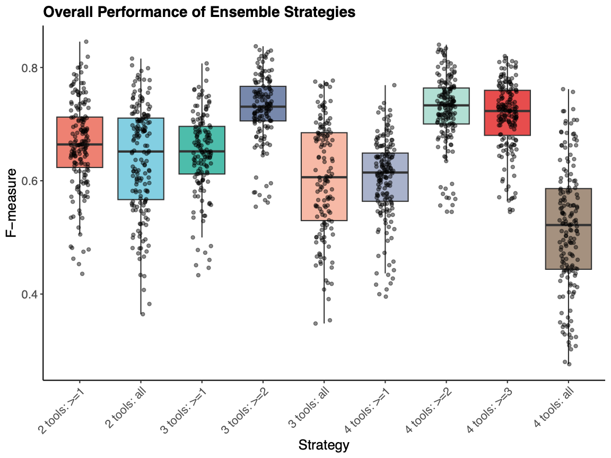
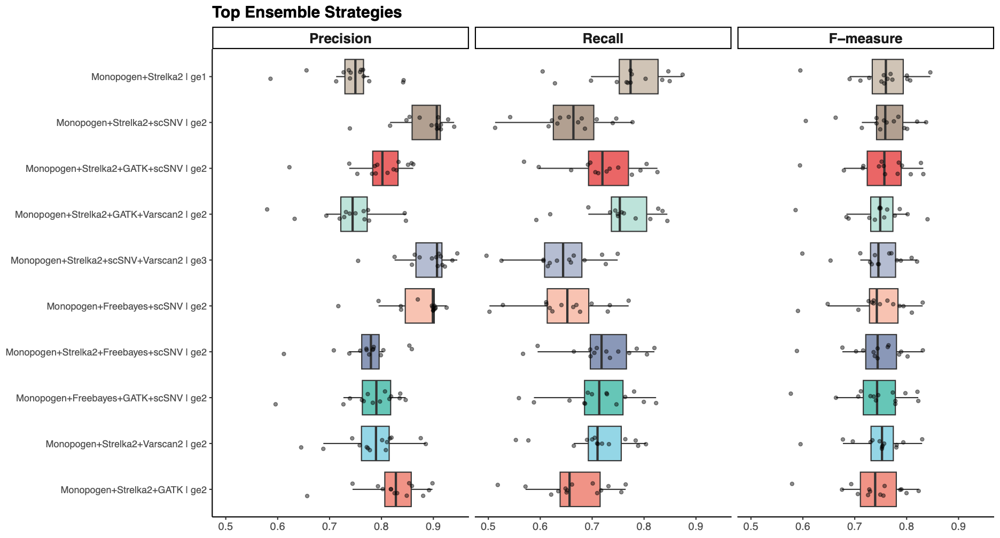
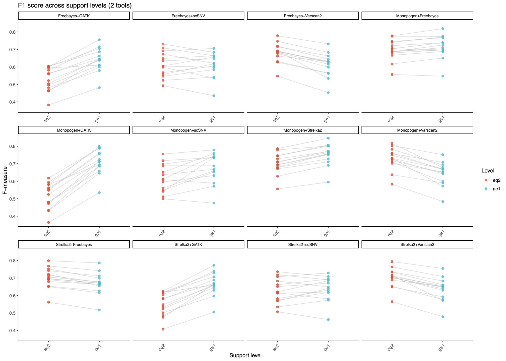
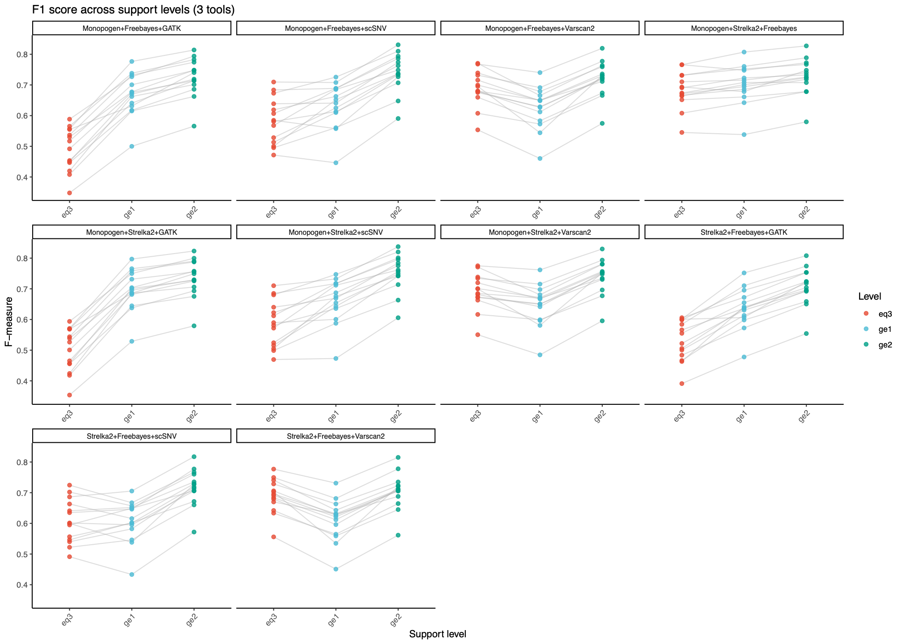
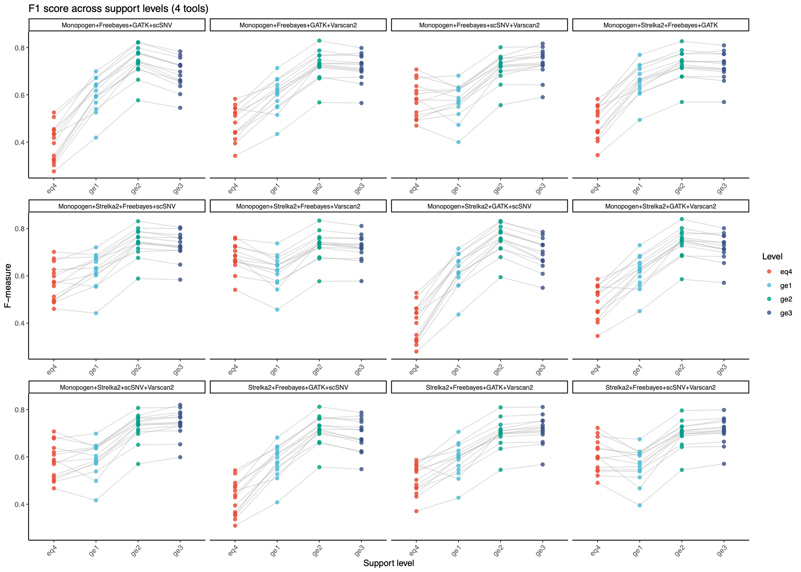

# Caller consensus {#consensus}

Caller consensus analysis was performed to evaluate whether combining variant calls from multiple tools improves variant calling performance. For each sample, variants were represented by normalized CHROM:POS:REF:ALT keys, and the number of supporting callers was counted. Combinations of two, three, and four callers were evaluated using different support thresholds, including the union (≥1 caller), intermediate consensus (≥2 or ≥3 callers), and intersection (supported by all callers). Each consensus call set was compared against the matched WES reference using RTG vcfeval within predefined callable regions to assess precision, recall, and F1-score.

The consensus analysis followed a similar workflow for both 10x Genomics and Smart-seq2 datasets. **Here, the 10x Genomics analysis is presented as a representative example.**

<details>
<summary>10x consensus RTG</summary>

```{bash, eval=FALSE}
combos=(
"Monopogen,Strelka2"
"Monopogen,Freebayes"
"Monopogen,GATK"
"Monopogen,scSNV"
"Monopogen,Varscan2"
"Strelka2,Freebayes"
"Strelka2,scSNV"
"Strelka2,Varscan2"
"Monopogen,Strelka2,Freebayes"
"Monopogen,Strelka2,GATK"
"Monopogen,Strelka2,scSNV"
"Monopogen,Strelka2,Varscan2"
"Monopogen,Freebayes,GATK"
"Monopogen,Freebayes,scSNV"
"Monopogen,Freebayes,Varscan2"
"Strelka2,Freebayes,GATK"
"Monopogen,Strelka2,Freebayes,GATK"
"Monopogen,Strelka2,Freebayes,scSNV"
"Monopogen,Strelka2,Freebayes,Varscan2"
"Strelka2,GATK"
"Freebayes,GATK"
"Freebayes,scSNV"
"Freebayes,Varscan2"
"Strelka2,Freebayes,scSNV"
"Strelka2,Freebayes,Varscan2"
"Monopogen,Strelka2,GATK,scSNV"
"Monopogen,Strelka2,GATK,Varscan2"
"Monopogen,Strelka2,scSNV,Varscan2"
"Monopogen,Freebayes,GATK,scSNV"
"Monopogen,Freebayes,GATK,Varscan2"
"Monopogen,Freebayes,scSNV,Varscan2"
"Strelka2,Freebayes,GATK,scSNV"
"Strelka2,Freebayes,GATK,Varscan2"
"Strelka2,Freebayes,scSNV,Varscan2"
)

POOL_BASE="/mnt/storage/tantingting/scmut/isec/pool_sites"
OUT_BASE="/mnt/storage/tantingting/scmut/isec/support_consensus_D1D2"
REF_SDF="/home/tantingting/scmut/ref/bwa_ref/genome.sdf"
mkdir -p "$OUT_BASE"

samples=("P4_cSCC" "P5_cSCC" "P6_cSCC" "P7_cSCC" "P9_cSCC" "P10_cSCC" "Acral1" "Acral2" "Acral3pre" "Acral3post" "Acral4" "Cutaneous1" "Cutaneous1Lym" "Cutaneous2")

get_truth_vcf() {
    local sample="$1"
    if [[ "$sample" == P*_cSCC ]]; then
        echo "/mnt/storage/tantingting/scmut/vcf/1_cSCC_WES/hap22/${sample}_hap_PASS3.vcf.gz"
    else
        case "$sample" in
            Acral1) echo "/mnt/storage/tantingting/scmut/vcf/2_melanoma_WES/hap/filter/SRR21849532_PASS.vcf.gz" ;;
            Acral2) echo "/mnt/storage/tantingting/scmut/vcf/2_melanoma_WES/hap/filter/SRR21849531_PASS.vcf.gz" ;;
            Acral3pre) echo "/mnt/storage/tantingting/scmut/vcf/2_melanoma_WES/hap/filter/SRR21849530_PASS.vcf.gz" ;;
            Acral3post) echo "/mnt/storage/tantingting/scmut/vcf/2_melanoma_WES/hap/filter/SRR21849529_PASS.vcf.gz" ;;
            Acral4) echo "/mnt/storage/tantingting/scmut/vcf/2_melanoma_WES/hap/filter/SRR21849528_PASS.vcf.gz" ;;
            Cutaneous1) echo "/mnt/storage/tantingting/scmut/vcf/2_melanoma_WES/hap/filter/SRR21849527_PASS.vcf.gz" ;;
            Cutaneous2) echo "/mnt/storage/tantingting/scmut/vcf/2_melanoma_WES/hap/filter/SRR21849526_PASS.vcf.gz" ;;
            Cutaneous1Lym) echo "/mnt/storage/tantingting/scmut/vcf/2_melanoma_WES/hap/filter/SRR21849525_PASS.vcf.gz" ;;
        esac
    fi
}

get_bed() {
    local sample="$1"
    if [[ "$sample" == P*_cSCC ]]; then
        local p=${sample%%_*}
        echo "/mnt/storage/tantingting/scmut/WES_gold/1_cSCC/region/whole/${p}_WES30_scRNA10_Shared_Genome.bed"
    else
        echo "/mnt/storage/tantingting/scmut/WES_gold/2_melanoma/region/whole/${sample}_Shared_Genome.bed"
    fi
}

make_vcf_from_keys() {
    local key_file="$1"
    local out_vcf="$2"
    {
        echo "##fileformat=VCFv4.2"
        for i in $(seq 1 22); do echo "##contig=<ID=chr${i}>"; done
        echo "##contig=<ID=chrX>"
        echo "##contig=<ID=chrY>"
        echo "##contig=<ID=chrM>"
        echo '##FORMAT=<ID=GT,Number=1,Type=String,Description="Genotype">'
        echo -e "#CHROM\tPOS\tID\tREF\tALT\tQUAL\tFILTER\tINFO\tFORMAT\tCONSENSUS"
        awk -F':' 'BEGIN{OFS="\t"}{print $1,$2,".",$3,$4,".","PASS",".","GT","0/1"}' "$key_file"
    } > "$out_vcf"
    bgzip -f "$out_vcf"
    tabix -f -p vcf "${out_vcf}.gz"
}

for sample in "${samples[@]}"; do
    echo "=============================="
    echo ">>> Processing $sample"
    echo "=============================="

    sample_out="${OUT_BASE}/${sample}"
    mkdir -p "$sample_out/tmp" "$sample_out/logs"

    truth_vcf=$(get_truth_vcf "$sample")
    bed_file=$(get_bed "$sample")

    [[ ! -f "$truth_vcf" ]] && { echo "[WARN] missing WES: $truth_vcf"; continue; }
    [[ ! -f "$bed_file" ]] && { echo "[WARN] missing BED: $bed_file"; continue; }

    for combo in "${combos[@]}"; do
         # Determine the combination size (2, 3, or 4 tools)
        IFS=',' read -ra tools <<< "$combo"
        n_tools=${#tools[@]}
        combo_name=$(echo "$combo" | tr ',' '+')
        combo_tag=$(echo "$combo" | tr ',' '_')

        merged="${sample_out}/tmp/${sample}.${combo_tag}.merged.tsv"
        support_table="${sample_out}/${sample}.${combo_tag}.support_count.tsv"
        : > "$merged"

        miss=0
        for tool in "${tools[@]}"; do
            key_file="${POOL_BASE}/${sample}_${tool}/query.keys"
            if [[ ! -f "$key_file" ]]; then
                echo "[WARN] missing key: $sample $tool"
                miss=1
                break
            fi
            awk -v T="$tool" 'BEGIN{FS=":";OFS="\t"}{print $1,$2,$3,$4,T}' "$key_file" >> "$merged"
        done
        [[ "$miss" -eq 1 ]] && continue

        awk 'BEGIN{FS=OFS="\t"}{
            key=$1"\t"$2"\t"$3"\t"$4
            if(!(seen[key,$5]++)){
                count[key]++
                toolset[key]=(toolset[key]==""?$5:toolset[key]","$5)
            }
        }END{
            for(k in count) print k,count[k],toolset[k]
        }' "$merged" | sort -k1,1V -k2,2n > "$support_table"

        if [[ "$n_tools" -eq 2 ]]; then
            levels=("ge1" "eq2")
        elif [[ "$n_tools" -eq 3 ]]; then
            levels=("ge1" "ge2" "eq3")
        else
            levels=("ge1" "ge2" "ge3" "eq4")
        fi

        for level in "${levels[@]}"; do
            case "$level" in
                ge1) expr='$5>=1' ;;
                ge2) expr='$5>=2' ;;
                ge3) expr='$5>=3' ;;
                eq2) expr='$5==2' ;;
                eq3) expr='$5==3' ;;
                eq4) expr='$5==4' ;;
            esac

            key_txt="${sample_out}/${sample}.${combo_tag}.${level}.keys.txt"
            out_vcf="${sample_out}/${sample}.${combo_tag}.${level}.vcf"
            rtg_out="${sample_out}/rtg_${combo_tag}_${level}"

            awk 'BEGIN{FS=OFS="\t"} '"$expr"' {print $1":"$2":"$3":"$4}' "$support_table" > "$key_txt"
            n_sites=$(wc -l < "$key_txt")
            echo "[INFO] $sample | $combo_name | $level | $n_sites sites"

            [[ "$n_sites" -eq 0 ]] && continue

            make_vcf_from_keys "$key_txt" "$out_vcf"

            rm -rf "$rtg_out"

            rtg vcfeval \
                -b "$truth_vcf" \
                -c "${out_vcf}.gz" \
                -t "$REF_SDF" \
                --bed-regions "$bed_file" \
                -o "$rtg_out" \
                --squash-ploidy \
                --output-mode=annotate \
                > "${sample_out}/logs/${combo_tag}_${level}.log" 2>&1
        done
    done

    rm -rf "${sample_out}/tmp"
done

echo "All done."
```

</details>

<details>
<summary>RTG summary collection</summary>

```{bash native-10x-consensus-rtg-summary-collection, eval=FALSE}
BASE="/mnt/storage/tantingting/scmut/isec/support_consensus_D1D2"
OUT="${BASE}/rtg_summary_all.tsv"

echo -e "Sample\tCombo\tLevel\tTP\tFP\tFN\tPrecision\tSensitivity\tF_measure" > "$OUT"

for summary in ${BASE}/*/rtg_*/summary.txt; do
    [[ -f "$summary" ]] || continue
    sample=$(basename "$(dirname "$(dirname "$summary")")")
    name=$(basename "$(dirname "$summary")" | sed 's/^rtg_//')
    level=${name##*_}
    combo=${name%_*}
    line=$(grep -E '^[[:space:]]*None[[:space:]]+' "$summary" | tail -1)
    [[ -z "$line" ]] && continue
    TP=$(echo "$line" | awk '{print $3}')
    FP=$(echo "$line" | awk '{print $4}')
    FN=$(echo "$line" | awk '{print $5}')
    P=$(echo "$line" | awk '{print $6}')
    R=$(echo "$line" | awk '{print $7}')
    F1=$(echo "$line" | awk '{print $8}')
    echo -e "${sample}\t${combo}\t${level}\t${TP}\t${FP}\t${FN}\t${P}\t${R}\t${F1}" >> "$OUT"
done

echo "Done: $OUT"
```

</details>

<details>
<summary>plotting</summary>

```{bash, eval=FALSE}
library(tidyverse)
library(ggsci)
library(scales)

base_dir <- "/mnt/storage/tantingting/scmut/isec/support_consensus_D1D2"
fig_dir <- "/mnt/storage/tantingting/scmut/figure_D1D2/figure3"

df <- read.table(file.path(base_dir, "rtg_summary_all.tsv"), header = TRUE, sep = "\t", stringsAsFactors = FALSE, check.names = FALSE)

df <- df %>%
  mutate(
    Combo = str_replace_all(Combo, "_", "+"),
    n_tools = str_count(Combo, "\\+") + 1,
    Strategy = case_when(
      n_tools == 2 & Level == "ge1" ~ "2 tools: >=1",
      n_tools == 2 & Level == "eq2" ~ "2 tools: all",
      n_tools == 3 & Level == "ge1" ~ "3 tools: >=1",
      n_tools == 3 & Level == "ge2" ~ "3 tools: >=2",
      n_tools == 3 & Level == "eq3" ~ "3 tools: all",
      n_tools == 4 & Level == "ge1" ~ "4 tools: >=1",
      n_tools == 4 & Level == "ge2" ~ "4 tools: >=2",
      n_tools == 4 & Level == "ge3" ~ "4 tools: >=3",
      n_tools == 4 & Level == "eq4" ~ "4 tools: all",
      TRUE ~ Level
    ),
    Strategy = factor(Strategy, levels = c("2 tools: >=1","2 tools: all","3 tools: >=1","3 tools: >=2","3 tools: all","4 tools: >=1","4 tools: >=2","4 tools: >=3","4 tools: all")),
    Dataset = ifelse(str_detect(Sample, "_cSCC$"), "cSCC", "Melanoma")
  )

p2 <- ggplot(df, aes(x = Strategy, y = F_measure, fill = Strategy)) +
  geom_boxplot(alpha = 0.7, outlier.shape = NA) +
  geom_jitter(width = 0.15, size = 1.3, alpha = 0.45) +
  scale_fill_npg() +
  theme_classic() +
  labs(title = "Overall Performance of Ensemble Strategies", x = "Strategy", y = "F-measure") +
  theme(legend.position = "none", axis.text.x = element_text(angle = 45, hjust = 1), axis.text = element_text(size = 11), axis.title = element_text(size = 13), plot.title = element_text(size = 14, face = "bold"))

ggsave(file.path(fig_dir, "f_measure_ensemble_boxplot.pdf"), p2, width = 8, height = 6)

top_n <- 10

df <- df %>%
  mutate(Strategy2 = paste0(Combo, " | ", Level))

top_strategy <- df %>%
  group_by(Strategy2) %>%
  summarise(mean_F1 = mean(F_measure, na.rm = TRUE), .groups = "drop") %>%
  arrange(desc(mean_F1)) %>%
  slice_head(n = top_n) %>%
  pull(Strategy2)

plot_df <- df %>%
  filter(Strategy2 %in% top_strategy) %>%
  mutate(Strategy2 = factor(Strategy2, levels = rev(top_strategy))) %>%
  select(Sample, Strategy2, Precision, Sensitivity, F_measure) %>%
  pivot_longer(cols = c(Precision, Sensitivity, F_measure), names_to = "Metric", values_to = "Value") %>%
  mutate(
    Metric = recode(Metric, Sensitivity = "Recall", F_measure = "F-measure"),
    Metric = factor(Metric, levels = c("Precision", "Recall", "F-measure"))
  )

p <- ggplot(plot_df, aes(x = Strategy2, y = Value, fill = Strategy2)) +
  geom_boxplot(alpha = 0.6, outlier.shape = NA) +
  geom_jitter(width = 0.15, size = 1.3, alpha = 0.45) +
  facet_wrap(~Metric, nrow = 1) +
  coord_flip() +
  scale_fill_npg() +
  theme_classic() +
  labs(title = "Top Ensemble Strategies", x = NULL, y = NULL) +
  theme(
    legend.position = "none",
    axis.text.y = element_text(size = 9),
    axis.text.x = element_text(size = 10),
    strip.text = element_text(size = 13, face = "bold"),
    plot.title = element_text(size = 15, face = "bold")
  )

ggsave(file.path(fig_dir, "top_ensemble_strategy_precision_recall_f1.pdf"), p, width = 13, height = 7)
```
</details>


```{r,  echo=FALSE , out.width = "400px",fig.align = 'center',  fig.cap = 'Comparison of overall F1-score across 34 consensus strategies evaluated using mutations derived from matched bulk WES as the truth sets. Consensus strategies were generated by combining six representative callers, with each strategy requiring support from at least two of the three primary callers (Monopogen, Strelka2, and FreeBayes).' , out.width='80%', fig.show='hold'}
library(knitr)


```


```{r,  echo=FALSE , out.width = "800px",fig.align = 'center',  fig.cap = 'Boxplot showing the ten best-performing consensus strategies ranked by F1-score. ', out.width='100%', fig.show='hold'}
library(knitr)

```


```{R, eval=FALSE}
df <- read.table(file.path(base_dir, "rtg_summary_all.tsv"), header = TRUE, sep = "\t", stringsAsFactors = FALSE, check.names = FALSE)

for (k in c(2,3,4)) {
  p <- df %>%
    filter(n_tools == k) %>%
    ggplot(aes(x = Level, y = F_measure, group = Sample)) +
    geom_line(color = "grey70", alpha = 0.45, linewidth = 0.5) +
    geom_point(aes(color = Level), size = 1.8, alpha = 0.8) +
    facet_wrap(~ Combo, scales = "free_x") +
    scale_color_npg() +
    theme_classic() +
    labs(title = paste0("F1 score across support levels (", k, " tools)"), x = "Support level", y = "F-measure", color = "Level") +
    theme(axis.text.x = element_text(angle = 45, hjust = 1), strip.text = element_text(size = 8), legend.position = "right")

  ggsave(file.path(fig_dir, paste0("f_measure_trajectory_", k, "tools.pdf")), p, width = 14, height = 10)
}
```

```{r,  echo=FALSE , out.width = "600px",fig.align = 'center',  fig.cap = 'F1-score comparison of two/three/four-tool consensus strategies for 10x Genomics scRNA-seq data.' , out.width='100%', fig.show='hold'}
library(knitr)




```


