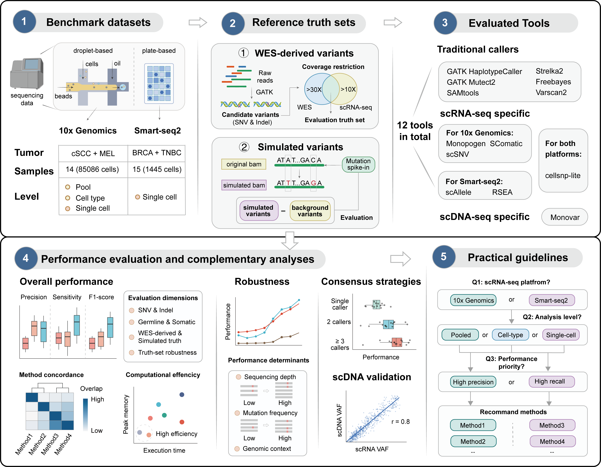

--- 
title: "Scmut"
date: "`r Sys.Date()`"
site: bookdown::bookdown_site
documentclass: book
bibliography:
- book.bib
- packages.bib
description: null
link-citations: yes
github-repo: "rstudio/bookdown-demo"
---

```{r setup, include=FALSE}
knitr::opts_chunk$set(results="asis")
#knitr::opts_chunk$set(eval=FALSE)
knitr::opts_chunk$set(echo=TRUE)
knitr::opts_chunk$set(warning=FALSE)
knitr::opts_chunk$set(message=FALSE)
knitr::opts_chunk$set(fig_cap="yes")
```

```{r,eval=FALSE,echo=FALSE}
bookdown::render_book('index.Rmd', 'bookdown::gitbook')
```


# Overview {#overview}

We established a systematic benchmarking framework to evaluate 11 variant callers across 29 tumor samples comprising 86,531 cells from 10x Genomics and Smart-seq2 datasets. Using matched whole-exome sequencing (WES) data as reference, we assessed variant calling performance at different analysis resolutions, complemented by in silico simulations and multi-caller consensus analyses to investigate factors influencing detection accuracy and potential strategies for improving performance.

This documentation provides a reproducible guide to the benchmarking workflow, including software versions, tool-specific configurations, variant calling and filtering procedures, performance evaluation, simulation protocols, and consensus-based analyses.

```{r,  echo=FALSE , out.width = "800px",fig.align = 'center',  fig.cap = 'Overview of the benchmarking framework for single-cell mutation calling.' }
library(knitr)

```

## Software and Environments
A total of 11 variant calling tools were evaluated across different sequencing platforms and analysis resolutions. The software versions, analysis scope, and corresponding Conda environments are summarized below.

| Tool | 10x Pooled | 10x Cell type | 10x Single-cell | Smart-seq2 | Version | Conda environment |
|:---|:---:|:---:|:---:|:---:|:---:|:---|
| GATK HaplotypeCaller | ✓ | — | — | ✓ | 4.6.2.0 | `scmut` |
| FreeBayes | ✓ | ✓ | — | ✓ | 1.3.10 | `freebayes` |
| SAMtools | ✓ | ✓ | — | ✓ | 1.13 | `scmut` |
| VarScan2 | ✓ | ✓ | — | ✓ | 2.4.6 | `scmut` |
| Strelka2 | ✓ | ✓ | — | ✓ | 2.9.10 | `py2` |
| Monopogen | ✓ | — | ✓ | — | 1.6.0 | `Monopogen` |
| SComatic | — | ✓ | — | — | 1.0 | `SComatic` |
| scSNV | ✓ | — | ✓ | — | 1.1 | `scsnv` |
| scAllele | — | — | ✓ | ✓ | 0.0.9.4 | `scallele` |
| cellsnp-lite | ✓ | ✓ | ✓ | ✓ | 1.2.3 | `scmut` |
| Monovar | — | ✓ | — | ✓ | 1.0 | `monovar` |


**Notes:**

- Monopogen was used for germline variant calling at the pooled level and somatic variant calling at the single-cell level.
- scSNV processes raw FASTQ files and generates single-cell-level variant calls, which were subsequently aggregated for pooled-level evaluation.
- Smart-seq2 datasets were evaluated exclusively at the single-cell level.
- Conda environment names correspond to the original analysis server. Detailed software dependencies and environment configurations are provided in the Docker setup and Conda environment specifications.


## Datasets

| Platform | Cohort | N | scRNA-seq | WES |
|:---|:---|---:|:---|:---|
| 10x | cSCC | 6 | GSE144236 | GSE144237 |
| 10x | Melanoma | 8 | GSE215120 | PRJNA862451 |
| Smart-seq2 | TNBC | 4 | GSE118389 | GSE118303 |
| Smart-seq2 | BRCA | 11 | GSE75688 | SRP067248 |

*Abbreviations:* cSCC, cutaneous squamous cell carcinoma; TNBC, triple-negative breast cancer; BRCA, breast cancer.

## Reference resources

| Resource | Benchmark choice |
|---|---|
| Genome | GRCh38 |
| BQSR known sites | dbSNP138, Mills and 1000G gold-standard indels, assembly38 known indels |
| Gene annotation | refGeneWithVer |
| Population annotation | gnomAD v4.1, avsnp151 |
| Somatic annotation | COSMIC v103 |
| Clinical annotation | ClinVar 20250721 |
| RNA editing | REDIportal v3 |
| Monopogen | 1000 Genomes haplotype panel |
| SComatic | hg38 RNA-editing sites and panel of normals |

